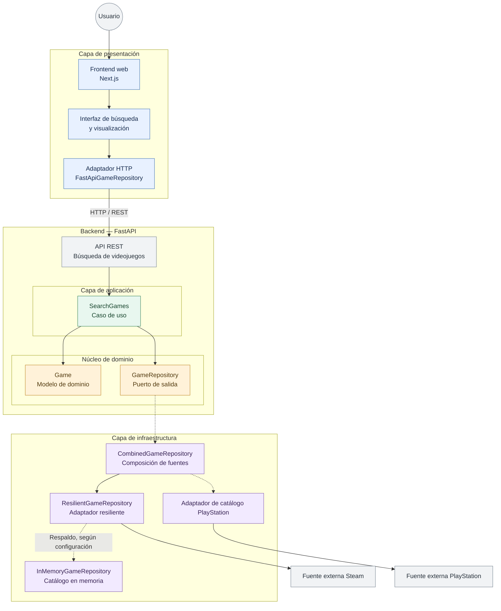
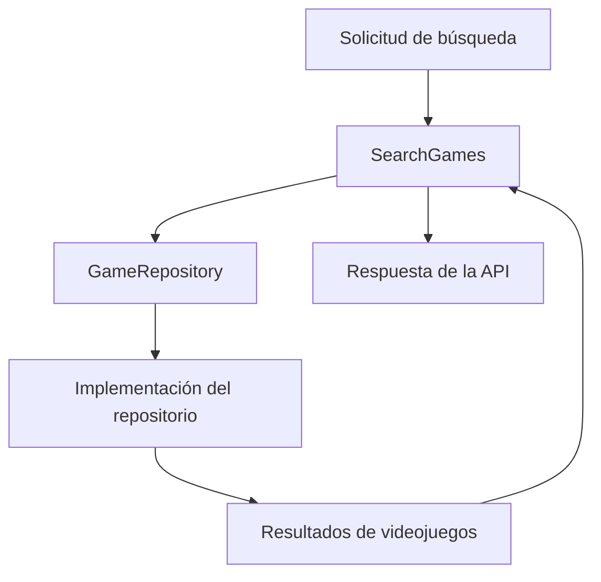
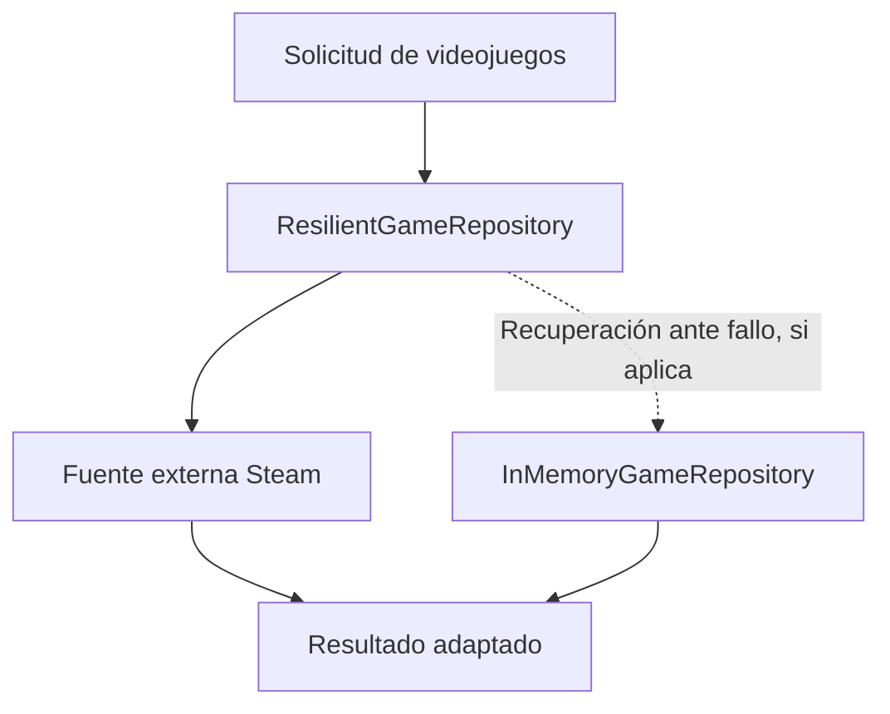

# 5. Vista de bloques

Esta sección presenta la descomposición estática de DRIFT en sus principales bloques arquitectónicos, sus responsabilidades y las relaciones entre ellos.

DRIFT utiliza una separación de responsabilidades basada en los principios de la arquitectura hexagonal (*Ports and Adapters*). La solución diferencia la interfaz web, los casos de uso de la aplicación, el modelo de dominio y los adaptadores de infraestructura que permiten acceder a fuentes de información externas.

La vista se centra en el flujo de búsqueda de videojuegos y en los componentes que participan en la recuperación y adaptación de la información. Las funcionalidades adicionales y las integraciones que todavía no forman parte de la implementación operativa se identifican como extensiones futuras.

## 5.1. Caja blanca: sistema global

DRIFT está compuesto por un frontend web, un backend que expone una API REST y una infraestructura de acceso a información de videojuegos.

El frontend permite al usuario realizar búsquedas y consultar los resultados. El backend recibe las solicitudes, delega la operación al caso de uso correspondiente y utiliza los contratos definidos por el dominio para acceder a la información.

La arquitectura desacopla la lógica de aplicación de los proveedores externos mediante puertos y adaptadores. De esta forma, los detalles particulares de una fuente de información no necesitan formar parte del caso de uso.

El diagrama representa la organización lógica de los componentes. Las relaciones entre los repositorios deben corresponder a la configuración efectiva del backend; en particular, la presencia de un adaptador no implica que participe en todas las solicitudes.

### 5.1.1. Responsabilidades de los bloques

| Bloque | Responsabilidad |
|---|---|
| Frontend web | Proporcionar la interfaz mediante la cual el usuario interactúa con DRIFT. |
| Interfaz de búsqueda | Capturar las consultas y presentar los videojuegos recuperados. |
| Adaptador HTTP | Comunicar el frontend con la API y adaptar las respuestas al modelo de la interfaz. |
| API REST | Exponer las operaciones del backend y recibir las solicitudes de búsqueda. |
| `SearchGames` | Coordinar la búsqueda y delegar el acceso a los datos mediante un contrato. |
| `Game` | Representar un videojuego dentro del modelo de dominio. |
| `GameRepository` | Definir el contrato de acceso a la información de videojuegos. |
| `CombinedGameRepository` | Coordinar las fuentes de información que efectivamente se hayan integrado. |
| `ResilientGameRepository` | Encapsular la estrategia de consulta y recuperación ante fallos de la fuente principal, de acuerdo con su implementación. |
| `InMemoryGameRepository` | Proporcionar información almacenada en memoria, sin garantizar persistencia entre reinicios. |
| Adaptador de catálogo PlayStation | Adaptar la información obtenida de la fuente PlayStation al formato utilizado por la aplicación, si está activo en el flujo desplegado. |

### 5.1.2. Puertos y dependencias

La arquitectura hexagonal define contratos para separar las necesidades de la aplicación de sus implementaciones concretas.

| Puerto o interfaz | Tipo | Propósito |
|---|---|---|
| API REST | Entrada | Permitir que el frontend invoque las operaciones del backend mediante HTTP. |
| `GameRepository` | Salida | Desacoplar el caso de uso de los mecanismos concretos de recuperación de videojuegos. |

El caso de uso depende del contrato del repositorio y no directamente de una tienda digital. Los adaptadores de infraestructura proporcionan las implementaciones que satisfacen ese contrato.

La selección y composición de los adaptadores dependen de la configuración real de la aplicación.

## 5.2. Caja blanca: núcleo de aplicación y dominio

El núcleo de DRIFT concentra la coordinación de los casos de uso y la representación de los videojuegos. Su diseño busca evitar que la lógica de aplicación dependa directamente de detalles de comunicación HTTP o de las particularidades de los proveedores externos.

### 5.2.1. Caso de uso de búsqueda

`SearchGames` coordina el proceso de búsqueda. Recibe los criterios de consulta, utiliza el contrato `GameRepository` para obtener los resultados y entrega la información a la capa de entrada.

La responsabilidad del caso de uso consiste en coordinar la operación. La comunicación con los proveedores externos y la adaptación de sus respuestas corresponden a la infraestructura.

Esta separación permite probar la lógica de aplicación con implementaciones controladas del repositorio y reduce la dependencia de los servicios externos durante las pruebas unitarias.

### 5.2.2. Caja blanca del modelo de dominio

El modelo `Game` representa la información de un videojuego utilizada por DRIFT. Su finalidad es proporcionar una estructura común para que la aplicación pueda trabajar con los resultados sin depender directamente del formato de cada proveedor.

El puerto `GameRepository` define las operaciones que necesita el caso de uso para acceder a la información. Las implementaciones concretas deben respetar este contrato.

El modelo de dominio y el puerto deben mantenerse independientes de los detalles particulares de transporte y comunicación externa, de acuerdo con las dependencias que establece el código.

## 5.3. Caja blanca: adaptadores de infraestructura

La infraestructura contiene los componentes encargados de conectar el núcleo de aplicación con las fuentes externas y los mecanismos concretos de acceso a datos.

### 5.3.1. Adaptador resiliente de Steam

`ResilientGameRepository` encapsula la estrategia de acceso a la fuente principal y la recuperación ante fallos, según el comportamiento implementado. Cuando la estrategia contempla una fuente alternativa en memoria, esta permite disponer de resultados de respaldo en los escenarios definidos por el código.

El adaptador busca aislar al resto de la aplicación de los detalles de integración con Steam y de la estrategia de recuperación. El comportamiento ante errores debe comprobarse mediante pruebas que cubran tanto las respuestas válidas como los fallos de comunicación.

La existencia de un mecanismo de respaldo no implica que todos los errores se recuperen automáticamente: la cobertura depende de las condiciones que implemente el adaptador.

### 5.3.2. Composición de fuentes de información

`CombinedGameRepository` representa la composición de fuentes cuando esta se encuentra configurada en el flujo de búsqueda. Su responsabilidad es proporcionar una interfaz uniforme al caso de uso y coordinar las implementaciones necesarias.

La composición no debe interpretarse como una garantía de que todos los proveedores se consulten simultáneamente. El comportamiento depende de las reglas definidas en el código, incluyendo la selección de fuentes, la combinación de resultados y el tratamiento de duplicados.

### 5.3.3. Catálogo en memoria

`InMemoryGameRepository` proporciona información mantenida en memoria. Puede funcionar como fuente controlada de datos o como respaldo de una fuente externa.

Este mecanismo no equivale a una base de datos persistente. Los datos mantenidos exclusivamente en memoria no deben considerarse conservados entre reinicios del proceso.

Si DRIFT incorpora almacenamiento permanente en una evolución posterior, la nueva implementación deberá documentarse como parte de la infraestructura y reflejarse en los diagramas correspondientes.

### 5.3.4. Integración del catálogo PlayStation

La integración de PlayStation debe documentarse de acuerdo con el alcance real de su adaptador y de las operaciones que lo utilizan.

Si el adaptador solo consulta información de catálogo, no debe presentarse como una integración completa de precios, compras, disponibilidad o historial de ofertas. Estas capacidades requieren evidencia de implementación independiente.

Las tiendas Epic, Xbox y Nintendo se considerarán extensiones futuras mientras no exista evidencia de que sus adaptadores forman parte del sistema operativo.

## 5.4. Extensiones arquitectónicas previstas

DRIFT puede evolucionar incorporando nuevas fuentes de información y capacidades. Estas extensiones deben distinguirse de los bloques que actualmente participan en el flujo desplegado.

| Extensión | Evolución propuesta |
|---|---|
| Nuevas tiendas digitales | Incorporar adaptadores que traduzcan la información de cada fuente al modelo común. |
| Persistencia permanente | Definir e implementar un repositorio respaldado por una base de datos si los requisitos lo necesitan. |
| Historial de precios | Almacenar observaciones de precios asociadas a videojuegos y fechas. |
| Recomendaciones | Definir los criterios, datos y casos de uso necesarios para sugerir videojuegos. |
| Compatibilidad de PC | Definir los requisitos de cada videojuego y las reglas para evaluar las especificaciones de un equipo. |

La inclusión de estas extensiones en esta tabla no significa que estén disponibles en producción. Su implementación debe acompañarse de pruebas y de la actualización de las vistas arquitectónicas.

## 5.5. Justificación de la descomposición

La organización de DRIFT responde a los siguientes criterios:

- **Separación de responsabilidades:** presentación, aplicación, dominio e infraestructura tienen responsabilidades diferenciadas.
- **Inversión de dependencias:** el caso de uso depende de un contrato y no de una fuente externa concreta.
- **Sustitución de implementaciones:** los adaptadores pueden sustituirse cuando respetan el contrato del puerto.
- **Facilidad de pruebas:** el uso de contratos permite probar los casos de uso con implementaciones controladas.
- **Evolución incremental:** las nuevas fuentes pueden incorporarse mediante adaptadores sin requerir necesariamente cambios en la lógica principal.

Estas propiedades representan objetivos arquitectónicos cuyo cumplimiento debe verificarse mediante el código, las pruebas y la configuración de ejecución.

## 5.6. Relación con la implementación

Los componentes de esta vista deben mantenerse sincronizados con el repositorio.

| Componente | Archivo de referencia |
|---|---|
| API REST | `backend/app/main.py` |
| Modelo de dominio | `backend/app/domain/model/game.py` |
| Puerto de repositorio | `backend/app/domain/ports/game_repository.py` |
| Caso de uso de búsqueda | `backend/app/application/usecases/search_games.py` |
| Adaptador Steam | `backend/app/infrastructure/external/steam/steam_game_repository.py` |
| Repositorio en memoria | `backend/app/infrastructure/persistence/in_memory_game_repository.py` |
| Adaptador HTTP del frontend | `frontend/infrastructure/http/FastApiGameRepository.js` |
| Caso de uso del frontend | `frontend/application/usecases/searchGames.js` |
| Componentes de interfaz | `frontend/ui/components/DriftHome.js` |

La presencia de un archivo no demuestra por sí sola que su componente participe en el flujo desplegado. Las dependencias, la configuración de ejecución y las pruebas deben utilizarse para confirmar las relaciones representadas.

La vista de bloques documenta, por tanto, la estructura lógica de DRIFT y las responsabilidades de sus componentes, diferenciando las integraciones operativas de las capacidades previstas para futuras versiones.
