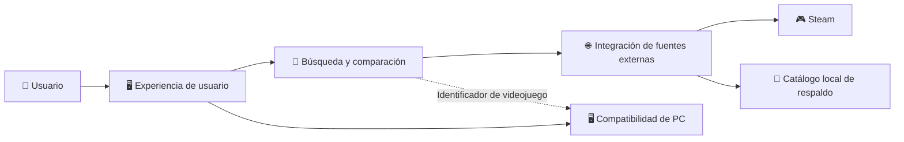
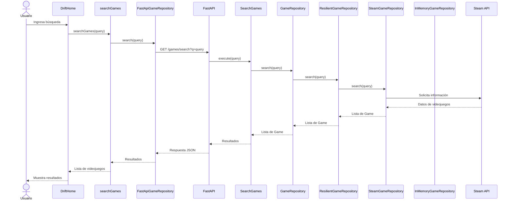

# 8. Conceptos transversales

En esta sección se presentan los conceptos que se aplican de forma transversal en la arquitectura de DRIFT y que permiten mantener una estructura organizada, fácil de modificar y con responsabilidades claramente delimitadas.

Estos conceptos se relacionan principalmente con la separación de responsabilidades, el lenguaje ubicuo, los contextos delimitados, la propiedad de los datos, el uso de puertos y adaptadores y la comunicación entre frontend, backend y las fuentes externas.

## 8.1 Lenguaje ubicuo

Para mantener una comprensión común entre los diferentes componentes del sistema, DRIFT utiliza los siguientes conceptos:

- **Videojuego:** elemento principal consultado por el usuario y representado mediante el modelo `Game`.
- **Búsqueda:** operación mediante la cual el usuario consulta videojuegos.
- **Precio:** información asociada a un videojuego proveniente de una fuente externa.
- **Fuente externa:** servicio externo que proporciona información para DRIFT, como Steam.
- **Fuente no disponible:** situación en la que una fuente externa no puede proporcionar información.
- **Catálogo de respaldo:** fuente local utilizada cuando la fuente principal no está disponible.
- **Compatibilidad:** evaluación de si el hardware del usuario cumple con los requisitos de un videojuego.
- **Requisito mínimo:** especificación mínima de hardware necesaria para ejecutar un videojuego.
- **Requisito recomendado:** especificación de hardware recomendada para ejecutar un videojuego.
- **Nivel de GPU:** valor utilizado por DRIFT para comparar la capacidad gráfica del equipo del usuario con los requisitos del videojuego.

## 8.2 Contextos delimitados

A partir del crecimiento funcional de DRIFT se identifican tres contextos delimitados de dominio y soporte:

- **Búsqueda y comparación:** responsable de la consulta y representación de la información de videojuegos utilizada por el usuario.
- **Integración de fuentes externas:** responsable de obtener información desde fuentes externas y gestionar la fuente de respaldo cuando una fuente principal no está disponible.
- **Compatibilidad de PC:** responsable de consultar los requisitos de un videojuego y estimar su compatibilidad con el hardware del usuario.

La **Experiencia de usuario** actúa como cliente de estos contextos y presenta sus resultados al usuario.

La separación de estos contextos permite mantener responsabilidades específicas sin modificar directamente los datos pertenecientes a otro contexto.

## 8.3 Context map

La relación entre los contextos y sus principales dependencias se representa de la siguiente manera:



Las relaciones principales son:

- La Experiencia de usuario consume las capacidades de Búsqueda y comparación y Compatibilidad de PC.
- Búsqueda y comparación utiliza Integración de fuentes externas para obtener información de videojuegos.
- Integración de fuentes externas se comunica con Steam y con el catálogo local de respaldo.
- Búsqueda y comparación proporciona el identificador del videojuego utilizado por Compatibilidad de PC.

## 8.4 Propiedad de los datos

Cada contexto mantiene la responsabilidad sobre los datos que le corresponden:


| Dato                          | Contexto responsable             |
|-------------------------------|----------------------------------|
| Game                          | Búsqueda y comparación         |
| Precios provenientes de Steam | Integración de fuentes externas |
| Catálogo local de respaldo   | Integración de fuentes externas |
| Datos de caché de Steam      | Integración de fuentes externas |
| GameRequirements              | Compatibilidad de PC             |
| Resultado de compatibilidad   | Compatibilidad de PC             |


La propiedad de los datos busca evitar que un contexto modifique directamente información administrada por otro contexto.

## 8.5 Separación de responsabilidades

DRIFT organiza sus componentes de acuerdo con la responsabilidad que cumplen dentro del sistema.

En el backend, la Arquitectura Hexagonal separa el dominio, los casos de uso y los adaptadores de infraestructura. En el frontend se separan la interfaz, la lógica de aplicación y la comunicación con el backend.

Las principales responsabilidades del backend son:

- **Dominio:** contiene modelos como `Game` y `GameRequirements`, además de los puertos `GameRepository` y `GameRequirementsRepository`.
- **Aplicación:** contiene los casos de uso `SearchGames` y `EstimateCompatibility`.
- **Infraestructura:** contiene adaptadores como `SteamGameRepository`, `CheapSharkGameRepository`, `PlayStationGameCatalogSource`, `InMemoryPlayStationCatalog`, `InMemoryGameRepository`, `ResilientGameRepository`, `InMemoryGameRequirementsRepository` y `SteamGameRequirementsRepository`.
- **Entrada:** `main.py` expone la API REST utilizada por el frontend.

Esta separación permite localizar los cambios en componentes específicos y reducir el acoplamiento entre responsabilidades.

## 8.6 Puertos y adaptadores

DRIFT utiliza el enfoque de Puertos y Adaptadores (Arquitectura Hexagonal) para reducir el acoplamiento entre la lógica de negocio y las tecnologías externas.

En el contexto de búsqueda, `GameRepository` define el puerto mediante el cual `SearchGames` solicita videojuegos sin depender directamente de una fuente concreta.

`SteamGameRepository` implementa este puerto para comunicarse con Steam, mientras que `InMemoryGameRepository` proporciona una fuente local de respaldo.

`ResilientGameRepository` coordina ambas fuentes y permite utilizar el catálogo de respaldo cuando la fuente principal no está disponible.

Para la compatibilidad de PC, `GameRequirementsRepository` define el puerto utilizado por `EstimateCompatibility`, cuya implementación actual es `FallbackGameRequirementsRepository`: primero consulta los requisitos curados por el equipo (`InMemoryGameRequirementsRepository`) y, si el juego no está, los de Steam (`SteamGameRequirementsRepository`).

De esta forma, los casos de uso permanecen desacoplados de las implementaciones concretas.

## 8.7 Modelo de dominio

El concepto principal del contexto de Búsqueda y comparación es `Game`, que representa un videojuego dentro de DRIFT.

En el backend, el modelo se encuentra en:

```
backend/app/domain/model/game.py
```

y contiene los datos básicos utilizados por el sistema:

- `id`
- `name`
- `prices`

El contexto de Compatibilidad de PC utiliza `GameRequirements` para representar los requisitos mínimos y recomendados de un videojuego.

En el frontend existe una representación de `Game` mediante:

```
frontend/domain/model/Game.js
```

Esta representación permite trabajar con los datos recibidos desde el backend dentro de la aplicación frontend. No constituye una segunda fuente de verdad, sino una representación utilizada por la interfaz.

## 8.8 Integración con fuentes externas

Steam es una fuente externa de información para DRIFT. La integración se realiza mediante `SteamGameRepository`, ubicado en:

```
backend/app/infrastructure/external/steam/steam_game_repository.py
```

Este componente se encarga de comunicarse con Steam y transformar la información obtenida al modelo `Game` utilizado por DRIFT.

Cuando la fuente principal no está disponible, `ResilientGameRepository` utiliza `InMemoryGameRepository` como fuente de respaldo.

Esta responsabilidad se mantiene aislada del caso de uso `SearchGames`, evitando que los detalles de las fuentes externas se propaguen hacia la lógica de aplicación.

## 8.9 Comunicación entre frontend y backend

El frontend y el backend se comunican mediante una API REST.

La búsqueda se realiza mediante el endpoint:

```
GET /games/search?q=<consulta>
```

El flujo comienza cuando el usuario realiza una búsqueda desde `DriftHome`. La solicitud pasa por `searchGames.js` y `FastApiGameRepository`, que se encarga de comunicarse con la API de FastAPI.

En el backend, la solicitud llega a `main.py`, donde se ejecuta el caso de uso `SearchGames`. Posteriormente, este utiliza `GameRepository` y la implementación correspondiente para obtener los resultados.

La funcionalidad de compatibilidad utiliza el mismo canal de comunicación entre frontend y backend, ejecutando el caso de uso `EstimateCompatibility`.

## 8.10 Flujo de búsqueda

El flujo principal de búsqueda se puede representar de la siguiente manera:



## 8.11 Relación con la mantenibilidad

Los conceptos anteriores contribuyen al atributo de calidad de mantenibilidad, definido como una prioridad para DRIFT.

La separación de responsabilidades permite localizar los cambios en partes específicas del sistema. Los contextos delimitados permiten establecer responsabilidades claras sobre los datos. El uso de puertos y adaptadores permite modificar una implementación externa sin cambiar directamente los casos de uso.

Por ejemplo, `SearchGames` puede continuar trabajando con `GameRepository` aunque cambie la implementación utilizada para obtener los videojuegos.

De esta manera, la arquitectura busca reducir el acoplamiento, evitar responsabilidades cruzadas y facilitar la evolución del sistema.

 

## Degradación controlada de fuentes (octubre de 2026)

- **Plazo por fuente:** cada fuente secundaria de la búsqueda dispone de `DRIFT_SOURCE_TIMEOUT_SECONDS` (3 s por defecto). Pasado el plazo, la búsqueda responde con lo que tiene.
- **Aviso explícito:** la fuente que falla o vence queda en `unavailable_sources` de cada resultado; el frontend lo muestra en la tarjeta del juego.
- **Caché sin bloqueo:** `SingleFlightCache` evita repetir consultas iguales sin serializar las distintas.
- **Observabilidad:** log JSON `source_unavailable` (fuente, motivo, espera) y métrica `drift_source_unavailable_total` en `/metrics`.

Decisión en [ADR-0008](../adr/0008-persistencia-ejecucion-y-degradacion-de-fuentes.md); medición en [E6](../evidencias/e6-degradacion-bajo-carga.md).

## 8.12 Idempotencia, sagas y outbox (evidencia S11)

**`GET /games/search` es una lectura.** Repetirla conserva su significado: devuelve el estado actual de las fuentes para esa consulta. Idempotencia no exige resultados idénticos en el tiempo: precios y descuentos de las tiendas pueden cambiar entre dos llamadas sin que la operación deje de ser idempotente. Efectos que sí produce, verificados en el código: una entrada en la caché en memoria de 60 s (`SingleFlightCache`), contadores en memoria de `SearchMetrics` y líneas de log. Son efectos operativos, no de negocio; no hay escrituras persistentes. Por eso no necesita una clave de idempotencia persistida.

**Única escritura existente.** `POST /games/sync/playstation` ejecuta `SyncPlayStationCatalog`: lee el catálogo de la fuente y reemplaza el catálogo en memoria con `replace`. Repetirlo deja el mismo estado final para los mismos datos de origen; si la lectura falla, o la fuente responde sin juegos utilizables, el catálogo local no se modifica (el endpoint responde 503 con `local_data_preserved`; ver §8.13). No coordina dos almacenes: lee de una fuente y escribe en un solo catálogo en memoria.

**Saga y outbox: no corresponden hoy.** Una saga coordina transacciones que abarcan varios servicios con compensaciones, y el outbox publica eventos de forma fiable junto con una escritura local. DRIFT no tiene ninguna operación de negocio que escriba en más de un almacén ni publica eventos: no hay compras, favoritos, alertas ni notificaciones. Implementarlos sería añadir complejidad sin un problema que resolver.

**Si se añaden escrituras repetibles.** Un cliente que reintente una escritura podría duplicar su efecto (por ejemplo, dos alertas de precio iguales). El mecanismo apropiado sería una clave de idempotencia enviada por el cliente, guardada de forma persistente junto con una restricción única sobre la operación, para que el segundo intento devuelva el resultado del primero. Esto requeriría persistencia, que hoy DRIFT no tiene (ADR-0008). Si esa escritura además debiera notificar a otro sistema, entonces sí se evaluaría un outbox.

Decisión relacionada: [ADR-0009](../adr/0009-decision-extraccion-integracion-steam.md). Riesgos: [arc42 §11.8](arc42-11-riesgos-y-deuda-tecnica.md).

## 8.13 Garantías de consistencia por operación (evidencia S12)

Esta sección responde, para cada operación real de DRIFT, qué garantía de consistencia ofrece, con qué alcance y qué **no** ofrece. Se verificó contra el código y las pruebas del repositorio; donde la implementación no garantiza una propiedad, se dice y no se presenta como cumplida.

### Qué se entiende por cada garantía

| Propiedad | Significado en DRIFT |
|---|---|
| Atomicidad de una actualización dentro del proceso | Un lector ve el estado anterior completo o el nuevo completo, nunca uno a medias. Depende de un `Lock` y del reemplazo de una referencia, y solo existe dentro de un proceso. |
| Consistencia de una lectura cacheada | Dos lecturas dentro de la ventana del TTL devuelven lo mismo; después, la siguiente recarga. No dice nada sobre si el valor sigue siendo el de la fuente. |
| Frescura de los datos externos | Cuánto puede diferir el dato servido del que tiene la fuente: como máximo el TTL, más el tiempo que tarde una recarga fallida en resolverse. |
| Consistencia entre fuentes distintas | Que los datos de Steam, CheapShark y PlayStation de un mismo resultado correspondan al mismo instante. **DRIFT no la ofrece.** |
| Consistencia entre instancias o réplicas | Que dos instancias respondan lo mismo. **DRIFT no la ofrece:** cada proceso tiene sus propias cachés y su propio catálogo, sin almacén compartido (ADR-0008). Con una sola instancia no hay diferencia observable; si el despliegue escala a más instancias o procesos, cada uno difiere hasta su TTL. |

Contexto verificado: toda la información vive en memoria del proceso (`SingleFlightCache`, `InMemoryPlayStationCatalog`, `OpenExchangeRateProvider`); no existe base de datos, broker ni caché compartida. El `Dockerfile` arranca un único proceso `uvicorn`; `startup.sh` arranca `gunicorn` sin fijar el número de procesos.

### Matriz (1/2): qué se protege, dónde y con qué garantía

| Operación | Datos afectados | Fuente de autoridad | Almacén | Garantía elegida | Alcance |
|---|---|---|---|---|---|
| **O1** Sincronización del catálogo PlayStation (`POST /games/sync/playstation`) | Lista de juegos PlayStation normalizados (primera página, 100 como máximo) | API del catálogo de la tienda PlayStation (endpoint sin contrato publicado) | `InMemoryPlayStationCatalog`, lista en memoria | **Reemplazo atómico de instantánea dentro del proceso.** No es consistencia fuerte global. | Un proceso. No cubre otras instancias ni reinicios. |
| **O2** Consulta cacheada a Steam (`GET /games/search`) | Lista de `Game` (nombre, precio en COP, imagen, enlaces) por consulta | Steam Storefront API (`storesearch`, `appdetails`) | `SingleFlightCache`, TTL 60 s, clave = consulta normalizada | **Lectura cacheada con frescura acotada por el TTL** y una sola carga por clave concurrente (single-flight). | Un proceso y una clave; sin relación entre claves. |
| **O3** Consulta cacheada a CheapShark (`GET /games/search`) | Ofertas por tienda convertidas a COP; lista de tiendas activas | API de CheapShark (`/deals`, `/stores`) y tasa de cambio | `SingleFlightCache` 60 s (con el precio ya convertido); lista de tiendas en memoria, 24 h | **Lectura cacheada con frescura acotada.** Consistencia entre fuentes: ninguna (se une con Steam por `steamAppID`). | Un proceso. Los precios de Steam y de CheapShark de un mismo juego pueden venir de instantes distintos (hasta 60 s). |
| **O4** Tasa de cambio USD→COP | Un número | open.er-api.com (publica una tasa al día); respaldo `USD_TO_COP_RATE` | Atributos de `OpenExchangeRateProvider`, TTL 12 h | **Valor único por proceso, actualizado por un solo hilo a la vez** (`Lock`); ante fallo, último valor conocido. | Un proceso. |
| **O5** Requisitos de compatibilidad (`POST /games/{id}/compatibility`) | Requisitos mínimos y recomendados por juego | Primero el catálogo curado del equipo; si no está, Steam `appdetails` | Curado: lista en memoria (versionada con el código). Steam: `SingleFlightCache`, 24 h por juego | Curado: **inmutable durante la vida del proceso.** Steam: **lectura cacheada con frescura acotada** (24 h). | Un proceso. |
| **O6** Catálogos de hardware (`GET /hardware/gpus`, `/cpus`, y puntajes de compatibilidad) | Puntajes de tarjetas gráficas y procesadores | Copia JSON del equipo (archivo local o dirección privada) | Índices en memoria, cargados una vez | **Instantánea inmutable por proceso.** | Un proceso; cambia con un reinicio. |

### Matriz (2/2): fallos, actualización y evidencia

| Operación | Comportamiento ante fallos | Regla de actualización e invalidación | Limitaciones | Prueba o código |
|---|---|---|---|---|
| **O1** | Error HTTP, timeout o respuesta inválida: 503 con `local_data_preserved: true` y el catálogo intacto. Una respuesta **sin juegos utilizables** se rechaza (`CatalogSyncRejected`, 503 `empty_catalog`) y tampoco borra el catálogo. Un reintento acotado (timeout 10 s). | Se actualiza solo cuando alguien llama al `POST`; cada llamada sustituye todo el catálogo (sin mezcla ni borrado parcial). No hay TTL ni tarea periódica: **el catálogo no caduca.** Si no hay coincidencia local, `search` consulta a PlayStation sin caché. | Solo la primera página de 100 juegos. Los datos pueden quedar obsoletos indefinidamente hasta el siguiente `POST`. Cada instancia necesita su propio `POST`; tras un reinicio el catálogo queda vacío. **Antes de S12, una respuesta con otra forma vaciaba el catálogo y respondía éxito con `games_loaded: 0`.** | `in_memory_playstation_catalog.py` (`replace` bajo `Lock`), `sync_playstation_catalog.py`. `test_s12_consistencia_y_fallos.py`: `test_replace_is_atomic_for_concurrent_readers_inside_one_process`, `test_sync_rejects_a_source_without_games_and_keeps_the_local_catalog`. `test_s12_sync_playstation_endpoint.py`. `test_playstation_catalog.py::test_failed_playstation_sync_preserves_local_catalog`. |
| **O2** | Timeout, 429, 5xx o respuesta inválida: el fallo **no se cachea**; `ResilientGameRepository` responde con el respaldo en memoria y marca `unavailable_sources: ["Steam"]`. Plazo total de la búsqueda: 4 s (`DRIFT_STEAM_TOTAL_DEADLINE_SECONDS`). | Sin invalidación por evento. Al vencer los 60 s, la siguiente consulta recarga (una sola carga aunque haya varias esperando). Un resultado vacío legítimo también se cachea 60 s. | Hasta 60 s de precios desactualizados por proceso. Si el respaldo no contiene el juego, la respuesta sale vacía **sin aviso** (arc42 §11.8). Steam puede devolver datos válidos pero erróneos: DRIFT no lo detecta. | `single_flight_cache.py`, `steam_game_repository.py`. `test_source_degradation.py` (single-flight y errores no cacheados), `test_steam_resilience.py`, `test_s12_plazo_total.py`, `test_s12_consistencia_y_fallos.py::test_cached_value_is_not_refreshed_before_the_ttl_even_if_the_source_changes` y `::test_a_failed_load_is_not_cached`. |
| **O3** | Fuente secundaria: si falla o vence su plazo (3 s), la búsqueda sigue y marca `unavailable_sources: ["CheapShark"]`. Una respuesta con otra forma es un **fallo** y no se cachea como «sin ofertas»; una lista vacía sí es «sin ofertas» y se cachea 60 s. Si falla el refresco de la lista de tiendas vencida, se usa la anterior. | TTL de 60 s (ofertas) y 24 h (tiendas); sin invalidación por evento. El precio cacheado conserva la tasa vigente cuando se cargó. | Una tienda nueva no se nombra hasta 24 h después. Sin lista de tiendas previa, la fuente falla. CheapShark limita las llamadas sin publicar la cifra: un único reintento. | `cheapshark_game_repository.py`. `test_cheapshark.py`, `test_s12_consistencia_y_fallos.py` (`test_cheapshark_*`, `test_combined_search_reports_a_typed_source_failure_without_failing`). |
| **O4** | Fallo o respuesta inválida: se sirve la última tasa conocida o la de respaldo, sin error para el usuario. Tras un fallo no se vuelve a consultar durante 5 min (20 min si la fuente respondió 429, que es su ventana de bloqueo documentada). Un único intento, timeout 3 s. | Expira a las 12 h; la fuente publica una vez al día. Sin invalidación por evento. | Con la fuente caída, la tasa vencida se sirve **sin aviso y sin límite de edad**. El `Lock` se mantiene durante la llamada HTTP (hasta 3 s): las búsquedas que necesitan la tasa esperan. El valor de respaldo es estático y puede ser incorrecto. La respuesta no indica qué tasa se usó. | `open_exchange_rate_provider.py`. `test_exchange_rate.py`, `test_s12_consistencia_y_fallos.py` (`test_exchange_rate_*`). |
| **O5** | Si Steam falla, el juego queda sin requisitos (componente «sin comparar») y el fallo **no se cachea**. «Steam no publica requisitos» (ausencia legítima) y «Steam no respondió» se distinguen en los registros. Un intento, timeout 3 s. | TTL 24 h para Steam; el catálogo curado cambia solo con un despliegue. | Un cambio de requisitos de Steam tarda hasta 24 h en verse. El analizador puede no reconocer algunos formatos (queda sin comparar). | `steam_game_requirements_repository.py`. `test_steam_requirements.py`, `test_s12_consistencia_y_fallos.py::test_steam_requirements_failure_is_not_cached_and_recovers`. |
| **O6** | Sin copia disponible, el catálogo queda vacío y el componente se compara por niveles; se reintenta la carga tras 5 min. | Carga en el primer uso; no hay TTL: cambia con un reinicio. | Actualizar puntajes exige reiniciar. No hay servicio de benchmarks remoto en la ruta de la petición. | `json_hardware_benchmark_repository.py`, `test_hardware_benchmarks.py`. |

### Lo que DRIFT no garantiza

- **Consistencia fuerte global.** Ni siquiera O1 la ofrece: el `Lock` y el reemplazo de referencia viven dentro de un proceso.
- **Consistencia entre instancias.** Dos instancias pueden mostrar catálogos y precios distintos hasta que venzan sus TTL, y la sincronización de PlayStation solo actualiza la instancia que recibió el `POST`.
- **Consistencia entre fuentes.** Un resultado combina Steam, CheapShark y PlayStation cargados en momentos distintos.
- **Durabilidad.** Un reinicio vacía cachés y catálogo.
- **Lecturas monótonas entre peticiones.** Una petición puede ver datos más nuevos que la siguiente si recarga una caché o la atiende otra instancia.

### Por qué estas garantías son las apropiadas

Las operaciones de DRIFT son lecturas de catálogos públicos y una única escritura que reemplaza una instantánea completa; no hay datos propios de usuario en el servidor ni transacciones entre almacenes (§8.12). Para precios que cambian cuando la tienda decide, una frescura acotada a 60 s es una decisión de producto barata y verificable (no hay un acuerdo de nivel de servicio sobre frescura: el valor es una elección del equipo, no un requisito medido). Una garantía más fuerte exigiría un almacén compartido (Redis o una base de datos), con costo operativo, y hoy no existe una operación cuyo valor lo justifique. Ese umbral se revisa según los criterios del [ADR-0010](../adr/0010-costo-de-reversion-de-las-decisiones-de-datos.md).

## 8.14 Política de invalidación y actualización por fuente (evidencia S12)

DRIFT **no invalida por evento** en ninguna fuente: la política es el TTL, más una regla de qué ocurre cuando la actualización falla. Actualizar una fuente no invalida las demás.

| Fuente | Qué datos y dónde | Cuánto se conservan | Evento que actualiza | Si la actualización falla | Al vencer el TTL | Cómo se evita servir un dato incorrecto como actual |
|---|---|---|---|---|---|---|
| **Steam, búsqueda** | `Game` por consulta, en `SingleFlightCache` | 60 s | Una consulta con la entrada vencida o ausente | No se guarda el fallo; se responde con el respaldo y `unavailable_sources: ["Steam"]` | La siguiente consulta recarga | El aviso del respaldo; el fallo nunca queda cacheado |
| **Steam, requisitos** | `GameRequirements` por juego, en `SingleFlightCache` | 24 h | Una consulta de compatibilidad con la entrada vencida | El juego queda sin requisitos (componente sin comparar); no se guarda el fallo | La siguiente consulta recarga | Un fallo se ve como «sin comparar», no como un requisito inventado |
| **CheapShark** | Ofertas ya convertidas a COP por consulta (60 s); tiendas activas (24 h) | 60 s y 24 h | Una consulta con la entrada vencida | Fuente marcada como no disponible; respuesta de otra forma = fallo y no se cachea; tiendas: se usa la lista anterior | Recarga | `unavailable_sources`; no se confunde fallo con «sin ofertas» |
| **Tasa de cambio** | Un número en el proveedor | 12 h | Una conversión de precio con la tasa vencida | Última tasa conocida o la de respaldo; sin nuevo intento durante 5 min (20 min tras un 429) | Se intenta actualizar; si falla, aplica la regla anterior | **No hay protección:** la tasa vencida se sirve sin aviso (limitación declarada en §8.13) |
| **Catálogo PlayStation** | Lista de juegos en `InMemoryPlayStationCatalog` | Sin vencimiento | Solo `POST /games/sync/playstation` | 503 con el catálogo anterior intacto; una respuesta sin juegos tampoco lo reemplaza | No aplica: no hay TTL | El catálogo sustituido es completo; el 503 declara `local_data_preserved` |
| **Catálogos de hardware** | Índices de puntajes en memoria | Vida del proceso | Primer uso tras el arranque | Catálogo vacío y reintento a los 5 min | No aplica | Sin puntaje, el componente se compara por niveles |

### Invalidación cruzada: dónde aplica y dónde no

- **PlayStation → Steam: no aplica.** Son fuentes independientes, con claves, almacenes y ciclos de vida distintos; sincronizar el catálogo de PlayStation no cambia ningún dato que Steam haya entregado. Invalidar la caché de Steam tras un `POST` solo costaría llamadas innecesarias.
- **Tasa de cambio → CheapShark: existe una dependencia real, pero no requiere invalidación.** Los precios de CheapShark se cachean ya convertidos. Cuando la tasa se actualiza, una entrada cargada con la tasa anterior sobrevive como máximo 60 s, que es el TTL de esa caché, mientras la fuente publica una tasa al día. El error acotado no justifica un mecanismo de invalidación.
- **Steam + CheapShark en un mismo resultado:** se unen por `steamAppID` sin sincronizar sus instantes (§8.13, O3).

### Riesgos reales encontrados y mejora mínima aplicada

| Riesgo observado en el código | Mejora (la más pequeña compatible con la arquitectura hexagonal) | Prueba |
|---|---|---|
| Una sincronización con respuesta de otra forma vaciaba el catálogo y respondía éxito | `SyncPlayStationCatalog` rechaza una fuente sin juegos (`CatalogSyncRejected`); el endpoint responde 503 con `local_data_preserved` | `test_sync_rejects_a_source_without_games_and_keeps_the_local_catalog`, `test_a_response_without_usable_games_does_not_wipe_the_local_catalog` |
| Con la tasa vencida y la fuente caída, cada búsqueda volvía a llamar (hasta 5 s con el `Lock` tomado); open.er-api.com bloquea 20 min ante abuso | Un intento, timeout 3 s y espera de 5 min tras un fallo (20 min tras un 429) | `test_exchange_rate_does_not_hammer_the_source_during_the_failure_backoff`, `test_exchange_rate_limited_response_backs_off_twenty_minutes` |
| CheapShark: una respuesta de otra forma se cacheaba como «sin ofertas»; si fallaba el refresco de tiendas, perdía toda la fuente | Respuesta inesperada = fallo no cacheado; lista de tiendas anterior si falla el refresco | `test_cheapshark_unexpected_shape_is_a_failure_and_is_not_cached`, `test_cheapshark_keeps_serving_with_the_stale_store_list_if_refresh_fails` |
| Steam: timeouts y reintentos de cada fase se sumaban sin tope | Plazo total compartido (`TimeBudget`), 4 s por defecto | `test_s12_plazo_total.py`; medición en [S12](../evidencias/s12-steam-degradado.md) |

No se añadió Redis ni ninguna otra infraestructura de caché.

## 8.15 Manejo de errores por fuente externa (evidencia S12)

Los detalles HTTP permanecen en los adaptadores: `get_json` (en `resilient_http.py`) aplica la política y eleva `ExternalSourceError` con un motivo tipado (`timeout`, `connection`, `rate_limited`, `server_error`, `client_error`, `invalid_response`); la búsqueda combinada lo traduce a `unavailable_sources` sin conocer HTTP. Las políticas **no son iguales**: cada una responde al contrato de su proveedor.

| Fuente | Timeout por llamada | Intentos | 429 y `Retry-After` | 5xx | 4xx permanente | Respuesta inválida | Plazo total | Por qué esta política |
|---|---|---|---|---|---|---|---|---|
| Steam, búsqueda | 3 s | 2 | Se respeta hasta 2 s | Se reintenta una vez | No se reintenta | Error, no «vacío» | 4 s | ADR-0009; fuente principal de la búsqueda |
| Steam, requisitos | 3 s | 1 | Sin espera: se informa | Sin reintento | No se reintenta | Sin requisitos (se registra) | — | Dato de apoyo de una consulta interactiva; el fallo solo deja un componente sin comparar |
| CheapShark | 3 s | 2 | Se respeta hasta 2 s | Se reintenta una vez | No se reintenta | Error, no «sin ofertas» | 3 s | El proveedor limita sin publicar la cifra y advierte de bloqueos: un solo reintento; el plazo iguala el de la fuente secundaria |
| PlayStation, sincronización | 10 s | 2 | Se respeta hasta 2 s | Se reintenta una vez | No se reintenta | Sin juegos utilizables = rechazo | — | Operación manual sobre un endpoint sin contrato publicado |
| PlayStation, búsqueda | 3 s | 2 | Se respeta hasta 2 s | Se reintenta una vez | No se reintenta | Error | 3 s | Fuente secundaria; antes no definía timeout propio |
| Tasa de cambio | 3 s | 1 | Espera de 20 min antes de volver a consultar | Espera de 5 min | Espera de 5 min | Espera de 5 min | — | Tiene tasa de respaldo; el proveedor responde 429 y bloquea 20 min ante abuso |
| Catálogos de hardware | 5 s (copia remota opcional) | 1 | — | — | — | Catálogo vacío | — | Sin cambios en S12: ya tenía timeout, tolerancia a fallos y reintento a los 5 min |

Ausencia legítima y fallo se distinguen: Steam sin coincidencias, CheapShark con lista vacía y requisitos que Steam no publica son resultados válidos; un timeout, un 5xx, un 429 o una respuesta de otra forma son fallos y quedan registrados (`external_retry`, `external_request_failed`, con motivo, intentos y milisegundos transcurridos, sin la consulta del usuario). Los registros de latencia por llamada están en el campo `elapsed_ms` de los fallos; las llamadas exitosas no se registran individualmente.
