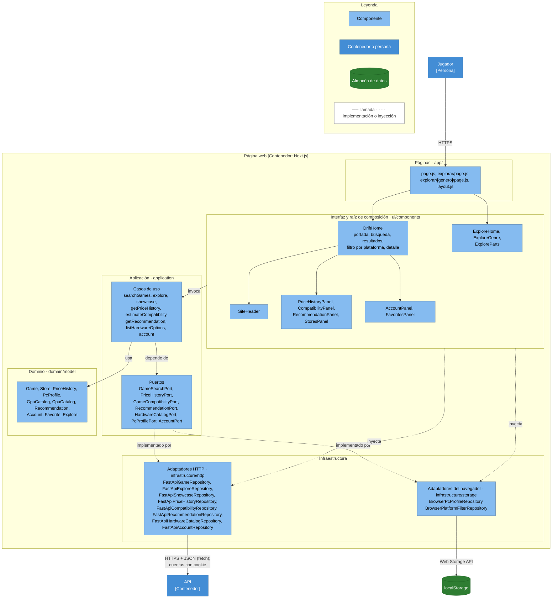
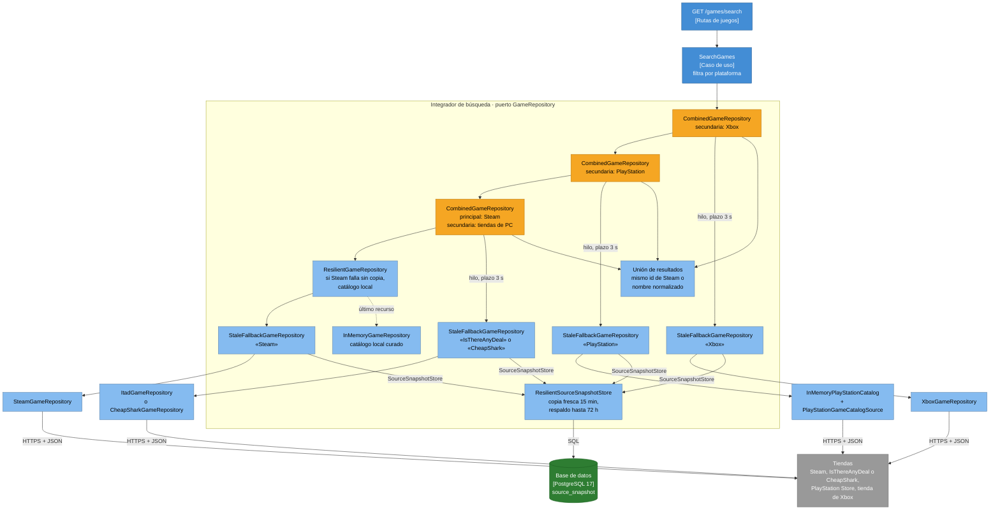
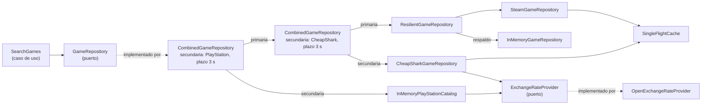

# C4 — Nivel 3: diagrama de componentes de DRIFT

> **Qué vista usar.** La [«Vista vigente»](#vista-vigente) describe el sistema que está en `master`. Lo que sigue a partir de [«Vista anterior»](#vista-anterior-octubre-de-2026) se conserva como registro: no incluye la base de datos, Xbox, IsThereAnyDeal, el historial, Explorar ni las cuentas.

## Vista vigente

Revisada el 23 de noviembre de 2026 contra `master` en `b841450` (el código no cambió desde `6bbf83e`). Cada componente corresponde a archivos que existen en el repositorio, y cada flecha a un `import` real o a una inyección hecha en la raíz de composición (`backend/app/main.py`). Incluye las decisiones de ADR-0013 a ADR-0024.

### Componentes de la API

La API sigue la arquitectura hexagonal ([ADR-0002](../adr/0002-adoptar-nextjs-fastapi-arquitectura-hexagonal.md)): las rutas llaman a casos de uso, los casos de uso dependen solo de puertos y modelos del dominio, y los adaptadores implementan esos puertos. `main.py` es la raíz de composición: crea los adaptadores y se los inyecta a los casos de uso. [`backend/tests/test_architecture.py`](../../backend/tests/test_architecture.py) falla si `domain/` o `application/` importan infraestructura.

```mermaid
flowchart TB
    WEB["Página web<br/>[Contenedor]"]
    ADMIN["Integrante del equipo<br/>[Persona]"]

    subgraph API["API [Contenedor: FastAPI]"]
        direction TB

        subgraph ENTRADA["Adaptadores de entrada · infrastructure/api, main.py"]
            ROUTES["Rutas de juegos y hardware<br/>[FastAPI]<br/>/games/search, /explore, /featured,<br/>/price-history, /compatibility,<br/>/recommendation, /stores, /hardware/*"]
            ACCOUNT_ROUTES["Rutas de cuentas<br/>[FastAPI APIRouter]<br/>/auth/*, /devices, /favorites"]
            ADMIN_ROUTES["Rutas administrativas<br/>[FastAPI]<br/>/games/sync/playstation,<br/>/hardware/benchmarks/sync, /metrics"]
            SECURITY["Seguridad<br/>[security.py]<br/>límite de tasa, token, CORS,<br/>origen y cookie de sesión"]
            OBS["Observabilidad<br/>[observability.py, code_fingerprint.py]<br/>logs JSON, SearchMetrics y huella<br/>del código desplegado"]
        end

        subgraph CASOS["Casos de uso · application/usecases"]
            SEARCH["SearchGames"]
            SHOWCASE["ListFeaturedGames, ExploreGames,<br/>ListStores"]
            HISTORY["GetPriceHistory"]
            COMPAT["EstimateCompatibility,<br/>RecommendPurchase,<br/>ListHardwareCatalogue"]
            ACCOUNTS["Sessions, Devices, Favorites,<br/>CheckFavoriteAlerts"]
            SYNC["SyncPlayStationCatalog,<br/>SyncHardwareBenchmarks"]
        end

        subgraph DOMINIO["Dominio · domain"]
            MODEL["Modelo<br/>Game, PriceHistory, User, Device,<br/>Favorite, SourceSnapshot,<br/>GameRequirements, HardwareBenchmark"]
            SERVICES["Servicios<br/>platforms, price_timeline,<br/>recommendation, price_alerts,<br/>gpu/cpu_classifier"]
            PORTS["Puertos<br/>GameRepository, FeaturedGamesSource,<br/>GameExplorer, PcStoreDirectory,<br/>PriceHistoryRepository, GameRequirementsRepository,<br/>HardwareBenchmarkRepository/Store,<br/>AccountRepository, IdentityProvider,<br/>CurrentPriceSource, SourceSnapshotStore,<br/>GameCatalogSource/Repository, ExchangeRateProvider"]
        end

        subgraph COMPOSICION["Adaptadores de composición · infrastructure/persistence"]
            COMBINED["Integrador de búsqueda<br/>CombinedGameRepository ×3<br/>consulta las fuentes a la vez<br/>con plazo y une los precios"]
            RESILIENT_GAME["ResilientGameRepository<br/>Steam con catálogo local<br/>de respaldo"]
            STALE["StaleFallbackGameRepository<br/>copia de respaldo por fuente"]
            REQS["FallbackGameRequirementsRepository<br/>requisitos curados, luego Steam"]
        end

        subgraph FUENTES["Adaptadores de salida a sistemas externos · infrastructure/external"]
            A_STEAM["Steam<br/>SteamGameRepository, SteamGameRequirementsRepository,<br/>SteamFeaturedGamesSource, SteamGameExplorer,<br/>SteamStoreItems"]
            A_ITAD["IsThereAnyDeal<br/>ItadClient (cuota), ItadGameRepository,<br/>ItadPriceHistoryRepository"]
            A_CHEAP["CheapSharkGameRepository"]
            A_PSN["PlayStationGameCatalogSource"]
            A_XBOX["XboxGameRepository"]
            A_GOOGLE["GoogleIdentityProvider"]
            A_FX["OpenExchangeRateProvider"]
            A_NOW["StoreCurrentPriceSource<br/>precio de hoy: Steam + ITAD"]
            HTTP["resilient_http + SingleFlightCache<br/>plazos, reintento, errores tipados,<br/>caché de 60 s de un solo vuelo"]
        end

        subgraph DATOS["Adaptadores de persistencia · infrastructure/persistence"]
            SNAP["Almacén de copias<br/>ResilientSourceSnapshotStore:<br/>PostgreSQL + memoria"]
            PG["Adaptadores PostgreSQL<br/>PostgresDatabase (pool, migraciones),<br/>PostgresSourceSnapshotStore,<br/>PostgresAccountRepository,<br/>PostgresHardwareBenchmarkStore"]
            MEM["Adaptadores en memoria<br/>InMemoryGameRepository, InMemoryPlayStationCatalog,<br/>InMemoryAccountRepository, InMemorySourceSnapshotStore,<br/>InMemoryGameRequirementsRepository"]
            BENCH["JsonHardwareBenchmarkRepository<br/>puntajes desde la base o la copia JSON"]
        end
    end

    DB[("Base de datos<br/>[PostgreSQL 17]")]
    EXT["Sistemas externos<br/>Steam, ITAD, CheapShark, PlayStation,<br/>Xbox, Google, open.er-api.com,<br/>copia de puntajes"]

    WEB -->|"HTTPS + JSON"| ROUTES
    WEB -->|"HTTPS + JSON, cookie"| ACCOUNT_ROUTES
    ADMIN -->|"HTTPS + JSON, Bearer"| ADMIN_ROUTES
    ROUTES -->|"usa"| SECURITY
    ACCOUNT_ROUTES -->|"usa"| SECURITY
    ADMIN_ROUTES -->|"usa"| SECURITY
    ROUTES -->|"registra"| OBS

    ROUTES --> SEARCH
    ROUTES --> SHOWCASE
    ROUTES --> HISTORY
    ROUTES --> COMPAT
    ACCOUNT_ROUTES --> ACCOUNTS
    ADMIN_ROUTES --> SYNC

    CASOS -->|"depende de"| PORTS
    CASOS -->|"usa"| MODEL
    CASOS -->|"usa"| SERVICES

    PORTS -.->|"GameRepository"| COMBINED
    PORTS -.->|"GameRequirementsRepository"| REQS
    PORTS -.->|"implementado por"| FUENTES
    PORTS -.->|"implementado por"| DATOS

    COMBINED -->|"fuente principal"| RESILIENT_GAME
    COMBINED -->|"fuentes secundarias"| STALE
    RESILIENT_GAME --> STALE
    RESILIENT_GAME -->|"respaldo"| MEM
    STALE -->|"envuelve"| A_STEAM
    STALE -->|"envuelve"| A_ITAD
    STALE -->|"envuelve"| A_CHEAP
    STALE -->|"envuelve"| A_XBOX
    STALE -->|"envuelve el catálogo"| MEM
    MEM -->|"busca en"| A_PSN
    STALE -->|"SourceSnapshotStore"| SNAP
    SNAP --> PG
    SNAP --> MEM
    REQS --> MEM
    REQS --> A_STEAM
    BENCH --> PG
    ACCOUNTS -.->|"AccountRepository"| PG
    ACCOUNTS -.->|"IdentityProvider"| A_GOOGLE
    ACCOUNTS -.->|"CurrentPriceSource"| A_NOW
    A_NOW --> A_STEAM
    A_NOW --> A_ITAD

    A_STEAM --> HTTP
    A_ITAD --> HTTP
    A_CHEAP --> HTTP
    A_PSN --> HTTP
    A_XBOX --> HTTP
    A_FX --> HTTP
    A_ITAD -->|"convierte a pesos"| A_FX
    A_CHEAP -->|"convierte a pesos"| A_FX
    A_PSN -->|"convierte a pesos"| A_FX
    A_XBOX -->|"convierte a pesos"| A_FX
    HTTP -->|"HTTPS + JSON"| EXT
    A_GOOGLE -->|"HTTPS + JSON, OIDC"| EXT
    BENCH -.->|"HTTPS + JSON"| EXT
    PG -->|"SQL, psycopg 3"| DB

    subgraph LEYENDA["Leyenda"]
        direction LR
        K1["Componente"]
        K2["Contenedor o persona externos al diagrama"]
        K3[("Almacén de datos")]
        K4["── llamada directa · - - - implementación de un puerto o inyección"]
    end

    classDef component fill:#85bbf0,stroke:#5d82a8,color:#000000
    classDef container fill:#438dd5,stroke:#2e6295,color:#ffffff
    classDef store fill:#2e7d32,stroke:#1b5e20,color:#ffffff
    classDef external fill:#999999,stroke:#6b6b6b,color:#ffffff
    classDef note fill:#ffffff,stroke:#999999,color:#333333

    class ROUTES,ACCOUNT_ROUTES,ADMIN_ROUTES,SECURITY,OBS,SEARCH,SHOWCASE,HISTORY,COMPAT,ACCOUNTS,SYNC,MODEL,SERVICES,PORTS,COMBINED,RESILIENT_GAME,STALE,REQS,A_STEAM,A_ITAD,A_CHEAP,A_PSN,A_XBOX,A_GOOGLE,A_FX,A_NOW,HTTP,SNAP,PG,MEM,BENCH,K1 component
    class WEB,ADMIN,K2 container
    class DB,K3 store
    class EXT external
    class K4 note
```

| Componente | Archivos | Responsabilidad |
|---|---|---|
| Rutas de juegos y hardware | `backend/app/main.py` | `GET /games/search`, `/games/explore`, `/games/featured`, `/games/{id}/price-history`, `/stores`, `/hardware/gpus`, `/hardware/cpus`; `POST /games/{id}/compatibility` y `/games/{id}/recommendation`. Validan la entrada con Pydantic. |
| Rutas de cuentas | `infrastructure/api/account_routes.py` | `/auth/google/login`, `/auth/google/callback`, `/auth/me` (GET y DELETE), `/auth/logout`, `/devices`, `/favorites`, `/favorites/alerts` y `/favorites/{id}/target`. Sin cliente de Google configurado responden 404 en el inicio de sesión y el resto de DRIFT sigue igual. |
| Rutas administrativas | `backend/app/main.py` | `POST /games/sync/playstation`, `POST /hardware/benchmarks/sync` y `GET /metrics`, con `Authorization: Bearer` (ADR-0011). |
| Seguridad | `infrastructure/api/security.py`, `account_routes.py` | `SlidingWindowRateLimiter` por cliente (ADR-0012), `require_admin_token`, CORS acotado, comprobación del `Origin` y cookie de sesión (ADR-0017). |
| Observabilidad | `infrastructure/observability.py`, `infrastructure/code_fingerprint.py` | Logs estructurados en JSON y `SearchMetrics` (latencia, fuentes no disponibles, copias usadas, cuota de ITAD) que lee `/metrics`. `GET /health` devuelve `code_fingerprint`, la huella SHA-256 del código de `app/`, para saber qué commit está desplegado (`scripts/verificar_despliegue.py`). |
| SearchGames | `application/usecases/search_games.py` | Busca en todas las tiendas por el puerto `GameRepository` y, si se piden plataformas, deja solo sus tiendas. |
| ListFeaturedGames, ExploreGames, ListStores | `application/usecases/showcase.py` | Portada (más vendidos de Steam), página «Explorar» por género y lista de tiendas conectadas. |
| GetPriceHistory | `application/usecases/get_price_history.py` | Historial del mejor precio en 12 meses, o el motivo por el que no hay (ADR-0016). |
| EstimateCompatibility, RecommendPurchase, ListHardwareCatalogue | `application/usecases/estimate_compatibility.py`, `recommend_purchase.py`, `list_hardware_catalogue.py` | Comparan el PC con los requisitos (por puntaje o por niveles), recomiendan dónde comprar y en qué dispositivo jugar (ADR-0019) y listan las GPU y CPU conocidas. |
| Sessions, Devices, Favorites | `application/usecases/accounts.py` | Iniciar y cerrar sesión, borrar la cuenta, administrar los dispositivos y los favoritos con su precio objetivo (ADR-0017, ADR-0020). |
| CheckFavoriteAlerts | `application/usecases/favorite_alerts.py`, `domain/services/price_alerts.py` | Precio de hoy de los favoritos y cuáles llegaron a su objetivo o bajaron 5 % (ADR-0021). |
| SyncPlayStationCatalog, SyncHardwareBenchmarks | `application/usecases/sync_*.py` | Cargas pedidas por el equipo; rechazan una respuesta vacía para no borrar lo guardado. |
| Dominio | `domain/model/`, `domain/services/`, `domain/ports/` | Entidades, reglas puras y los 15 puertos. No importa nada fuera de `domain/`. `platforms.py` distingue las tiendas con precio de Colombia (Steam, PlayStation, Xbox) de las de referencia (precios de EE. UU. convertidos), y la recomendación y las alertas prefieren las primeras (ADR-0024). |
| CombinedGameRepository (integrador de búsqueda) | `persistence/combined_game_repository.py` | Es el integrador de búsqueda que muestran los niveles 1 y 2; su despliegue completo está [abajo](#integrador-de-búsqueda-desplegado). Lanza cada fuente secundaria en un hilo, aplica el plazo (`DRIFT_SOURCE_TIMEOUT_SECONDS`) y une los precios por identificador de Steam o por nombre normalizado. Se anida tres veces en `main.py` para combinar las cuatro fuentes. |
| ResilientGameRepository | `persistence/resilient_game_repository.py`, `persistence/in_memory_game_repository.py` | Si Steam falla del todo, responde con el catálogo local curado. |
| StaleFallbackGameRepository | `persistence/stale_fallback_game_repository.py` | Envuelve cada fuente: copia fresca 15 minutos sin llamar a la fuente; si falla, copia de hasta 72 horas marcada en `cached_sources` (ADR-0015). |
| FallbackGameRequirementsRepository | `persistence/fallback_game_requirements_repository.py` | Requisitos curados por el equipo y, para el resto, los de Steam. |
| Almacén de copias | `persistence/resilient_source_snapshot_store.py`, `source_snapshot_store_factory.py` | Escribe en PostgreSQL y en memoria; si PostgreSQL falla, deja de llamarlo 30 segundos. Sin `DRIFT_DATABASE_URL`, solo memoria. |
| Adaptadores PostgreSQL | `persistence/postgres_database.py`, `postgres_source_snapshot_store.py`, `postgres_account_repository.py`, `postgres_hardware_benchmark_store.py` | Pool de conexiones con plazos cortos, migraciones versionadas y las tablas de copias, cuentas y puntajes (ADR-0014). |
| Adaptadores en memoria | `persistence/in_memory_*.py` | Catálogo local, catálogo de PlayStation, requisitos curados, y cuentas y copias cuando no hay base de datos. |
| JsonHardwareBenchmarkRepository | `persistence/json_hardware_benchmark_repository.py` | Lee los puntajes de la base o de la copia JSON y reconoce modelos dentro del texto de los requisitos (ADR-0018). |
| Adaptadores de Steam | `external/steam/` | Búsqueda y precio en pesos, requisitos, precio regional para el historial, más vendidos y «Explorar». |
| Adaptadores de IsThereAnyDeal | `external/isthereanydeal/` | Cliente con control de cuota, precios de tiendas de PC, directorio de tiendas e historial. |
| CheapShark, PlayStation, Xbox, Google, tasa de cambio | `external/cheapshark/`, `playstation/`, `xbox/`, `google/`, `exchange/` | Un adaptador por sistema externo. |
| StoreCurrentPriceSource | `external/store_current_prices.py` | Mejor precio de PC de varios juegos a la vez (Steam e IsThereAnyDeal), con caché de una hora, para las alertas. |
| resilient_http y SingleFlightCache | `external/resilient_http.py`, `external/single_flight_cache.py` | Plazo por intento y plazo total, un reintento ante fallos transitorios, errores con causa, y caché de 60 s que junta peticiones iguales simultáneas. |

### Componentes de la página web

Dominio y aplicación del frontend no importan infraestructura ni interfaz; los componentes de interfaz hacen de **raíz de composición**: importan los adaptadores HTTP y de almacenamiento y se los pasan a los casos de uso. La regla la comprueba `scripts/validar_docs.py` en el CI.

| Componente | Archivos | Responsabilidad |
|---|---|---|
| Páginas | `frontend/app/` | Rutas `/`, `/explorar` y `/explorar/[genero]` del App Router. |
| DriftHome | `ui/components/DriftHome.js` | Página principal: portada con los más vendidos, búsqueda, resultados, filtro «Tengo:» y detalle del juego. Es la raíz de composición de la búsqueda y del detalle. |
| ExploreHome, ExploreGenre, ExploreParts | `ui/components/Explore*.js` | Página «Explorar»: géneros y juegos de cada género con su ficha de Steam. |
| SiteHeader | `ui/components/SiteHeader.js` | Encabezado con el acceso a «Mi cuenta». |
| Paneles del detalle | `PriceHistoryPanel.js`, `CompatibilityPanel.js`, `RecommendationPanel.js`, `StoresPanel.js` | Historial (cifras, gráfica, tabla), compatibilidad por componente, opción recomendada con su motivo y tiendas por plataforma. |
| AccountPanel, FavoritesPanel | `ui/components/AccountPanel.js`, `FavoritesPanel.js` | Botón de Google, dispositivos, cerrar sesión, borrar la cuenta; juegos guardados con su precio de hoy y su alerta. |
| Casos de uso y puertos | `frontend/application/` | Validan antes de salir a la red y dependen de puertos, no de `fetch`. |
| Modelo | `frontend/domain/model/` | Reglas que no dependen de la interfaz: plataforma de cada tienda, filtro, catálogos de hardware, cuándo aplica la compatibilidad o el historial. |
| Adaptadores HTTP | `frontend/infrastructure/http/` | Una llamada a la API por puerto; los de cuentas envían la cookie de sesión (`credentials: "include"`). |
| Adaptadores del navegador | `frontend/infrastructure/storage/` | Perfil del PC y plataformas elegidas en `localStorage`. |

### Integrador de búsqueda desplegado

Los niveles [1](contexto.md) y [2](contenedores.md) muestran el integrador de búsqueda como una sola caja, sin las tiendas. Aquí se despliega tal como lo arma `backend/app/main.py`: tres `CombinedGameRepository` anidados detrás del puerto `GameRepository`, que `SearchGames` usa sin saber cuántas tiendas hay. Cada uno lanza su fuente secundaria en un hilo antes de consultar la principal, así que las cuatro fuentes se consultan a la vez.

Las cajas naranjas son los tres `CombinedGameRepository` que forman el integrador; las azules claras, sus piezas y adaptadores. El plazo de las fuentes secundarias es `DRIFT_SOURCE_TIMEOUT_SECONDS` (3 s); Steam tiene su propio plazo total de 4 s (ADR-0013).

| Situación de una tienda | Qué hace el integrador | Dónde |
|---|---|---|
| Hay una copia de menos de 15 min | Responde con la copia sin llamar a la tienda | `StaleFallbackGameRepository` |
| Responde a tiempo | Usa la respuesta y guarda una copia nueva en PostgreSQL y en memoria | `StaleFallbackGameRepository`, `ResilientSourceSnapshotStore` |
| Falla o pasa su plazo, con copia de menos de 72 h | Usa la copia y la marca en `cached_sources` con su fecha | `StaleFallbackGameRepository.last_known`, `CombinedGameRepository` |
| Falla o pasa su plazo, sin copia | La marca en `unavailable_sources` y sigue con las demás | `CombinedGameRepository` |
| Falla Steam sin copia | Responde con el catálogo local y marca Steam como no disponible | `ResilientGameRepository` |
| La base de datos no responde | Las copias se leen y escriben solo en memoria durante 30 s | `ResilientSourceSnapshotStore` |

Fuera del integrador, la portada y «Explorar» van directo a Steam, el historial a IsThereAnyDeal y las alertas de favoritos a Steam e IsThereAnyDeal (diagrama de componentes de la API). En los niveles 1 y 2 esas llamadas quedan dentro de la caja del integrador.

### Recorrido de una búsqueda

1. La página llama a `GET /api/games/search?q=…`. El límite de tasa cuenta la petición (ADR-0012).
2. `SearchGames` llama al puerto `GameRepository`, que implementa `CombinedGameRepository`.
3. Las cuatro fuentes (Steam, IsThereAnyDeal o CheapShark, PlayStation y Xbox) se consultan a la vez, cada una envuelta en `StaleFallbackGameRepository`:
   - con una copia de menos de 15 minutos no se llama a la fuente;
   - si la fuente responde, se guarda su copia en PostgreSQL y en memoria;
   - si falla o excede su plazo, se usa la copia de hasta 72 horas y se marca en `cached_sources`;
   - sin copia, la fuente queda en `unavailable_sources`;
   - si Steam falla del todo, `ResilientGameRepository` responde con el catálogo local.
4. Los precios se unen en un solo juego por identificador de Steam o por nombre normalizado.
5. La API registra la latencia en `SearchMetrics`, escribe un log JSON sin la consulta y devuelve precios, enlaces, descuentos y plataformas; la página aplica el filtro «Tengo:».

### Nivel 4 (código)

DRIFT no mantiene diagramas de nivel 4: el código es la fuente de verdad y las clases de cada componente están enlazadas en las tablas anteriores. Las vistas de código que existieron en la [vista anterior](#vista-anterior-octubre-de-2026) son históricas.

---

## Vista anterior (octubre de 2026)

> **Estado: anterior.** Describe el sistema antes de ADR-0014 a ADR-0018. Se conserva como registro.

El diagrama de nivel 3 muestra con mayor detalle la estructura interna de DRIFT y la comunicación entre los componentes que participan en la búsqueda de videojuegos. Se representan los componentes que actualmente existen en el repositorio, sin agregar componentes o funcionalidades que no estén implementados.

```mermaid
flowchart LR

    %% =====================================================
    %% ACTORES Y SISTEMAS EXTERNOS
    %% =====================================================

    USER["👤 Usuario / Jugador<br/><br/>Busca videojuegos,<br/>consulta precios y compatibilidad"]

    STEAM["🎮 Steam API<br/><br/>Servicio externo que proporciona<br/>información y precios de videojuegos"]

    PLAYSTATION["🎮 PlayStation API<br/><br/>Fuente externa del catálogo<br/>de videojuegos de PlayStation"]


    %% =====================================================
    %% FRONTEND
    %% =====================================================

    subgraph FRONTEND["🟦 DRIFT — Frontend Web"]

        subgraph UI["🖥️ Capa de Interfaz"]

            PAGE["📄 page.js<br/><br/>Punto de entrada de la<br/>aplicación web"]

            HOME["🎨 DriftHome<br/><br/>Interfaz principal de DRIFT<br/>para realizar búsquedas y<br/>consultar compatibilidad"]

        end


        subgraph FRONT_APP["⚙️ Capa de Aplicación"]

            FRONT_SEARCH["🔎 searchGames.js<br/><br/>Caso de uso del frontend<br/>para buscar videojuegos"]

            FRONT_PORT["🔗 GameSearchPort.js<br/><br/>Puerto utilizado para<br/>realizar la búsqueda"]

        end


        subgraph FRONT_INFRA["🌐 Capa de Infraestructura"]

            HTTP["🌐 FastApiGameRepository.js<br/><br/>Adaptador HTTP que implementa<br/>GameSearchPort y consume<br/>la API REST del backend"]

            COMPAT_HTTP["🌐 FastApiCompatibilityRepository.js<br/><br/>Adaptador HTTP utilizado para<br/>consultar la compatibilidad"]

        end

    end


    %% =====================================================
    %% BACKEND
    %% =====================================================

    subgraph BACKEND["🟪 DRIFT — Backend / API"]

        subgraph API_LAYER["🔌 Capa de Entrada"]

            API["🔌 main.py — FastAPI<br/><br/>Expone la API REST de DRIFT<br/><br/>Recibe solicitudes HTTP y<br/>ejecuta los casos de uso"]

        end


        subgraph APPLICATION["⚙️ Capa de Aplicación"]

            SEARCH["🔎 SearchGames<br/><br/>Caso de uso de búsqueda<br/>de videojuegos<br/><br/>Utiliza GameRepository"]

            SYNC_PS["🔄 SyncPlayStationCatalog<br/><br/>Caso de uso para actualizar<br/>el catálogo de PlayStation"]

            COMPAT["🖥️ EstimateCompatibility<br/><br/>Caso de uso de compatibilidad<br/>de PC"]

        end


        subgraph DOMAIN["🧠 Capa de Dominio"]

            GAME["🎮 Game<br/><br/>Entidad del dominio<br/><br/>id<br/>name<br/>prices"]

            PORT["🔗 GameRepository<br/><br/>Puerto del dominio<br/><br/>Define search(query)"]

            CATALOG_PORT["🔗 GameCatalogSource<br/><br/>Puerto para obtener<br/>un catálogo externo"]

            NORMALIZED_GAME["📦 NormalizedGame<br/><br/>Modelo normalizado utilizado<br/>para el catálogo externo"]

            REQUIREMENTS["🧩 GameRequirements<br/><br/>Modelo del dominio para<br/>requisitos de PC"]

            REQUIREMENTS_PORT["🔗 GameRequirementsRepository<br/><br/>Puerto para consultar<br/>requisitos de PC"]

        end


        subgraph INFRASTRUCTURE["🏗️ Capa de Infraestructura"]

            STEAM_REPO["🎮 SteamGameRepository<br/><br/>Adaptador externo<br/><br/>Implementa GameRepository<br/>y consulta Steam"]

            RESILIENT_REPO["🛡️ ResilientGameRepository<br/><br/>Implementa GameRepository<br/><br/>Usa Steam como fuente principal<br/>y un catálogo local de respaldo"]

            MEMORY_REPO["💾 InMemoryGameRepository<br/><br/>Repositorio local de respaldo<br/><br/>Implementa GameRepository"]

            COMBINED_REPO["🔀 CombinedGameRepository<br/><br/>Implementa GameRepository<br/><br/>Combina los resultados del<br/>repositorio principal con<br/>el catálogo local de PlayStation"]

            PS_SOURCE["🎮 PlayStationGameCatalogSource<br/><br/>Adaptador externo<br/><br/>Implementa GameCatalogSource,<br/>consulta PlayStation y normaliza<br/>los datos del catálogo"]

            PS_CATALOG["💾 InMemoryPlayStationCatalog<br/><br/>Catálogo local de PlayStation<br/><br/>Implementa GameRepository<br/>y almacena los juegos<br/>obtenidos mediante sincronización"]

            REQUIREMENTS_REPO["💾 InMemoryGameRequirementsRepository<br/><br/>Repositorio en memoria<br/><br/>Implementa GameRequirementsRepository"]

        end

    end


    %% =====================================================
    %% PERSISTENCIA PREVISTA
    %% =====================================================

    DB["🗄️ Base de datos DRIFT<br/><br/>Persistencia prevista<br/>para una evolución futura<br/><br/>No implementada actualmente"]


    %% =====================================================
    %% FLUJO PRINCIPAL DEL FRONTEND
    %% =====================================================

    USER -->|"1. Busca un videojuego"| HOME

    PAGE -->|"2. Carga la aplicación"| HOME

    HOME -->|"3. Solicita búsqueda"| FRONT_SEARCH

    FRONT_SEARCH -->|"4. Utiliza el puerto"| FRONT_PORT

    FRONT_PORT -->|"5. Implementado por"| HTTP

    HTTP -->|"6. GET /games/search?q=..."| API


    %% =====================================================
    %% BÚSQUEDA EN EL BACKEND
    %% =====================================================

    API -->|"7. Ejecuta SearchGames"| SEARCH

    SEARCH -->|"8. Solicita búsqueda"| PORT

    PORT -.->|"9. Implementado por"| COMBINED_REPO


    %% =====================================================
    %% COMBINACIÓN DE FUENTES
    %% =====================================================

    COMBINED_REPO -->|"10. Consulta repositorio principal"| RESILIENT_REPO

    COMBINED_REPO -->|"11. Consulta catálogo PlayStation"| PS_CATALOG


    %% =====================================================
    %% RESILIENCIA DE STEAM
    %% =====================================================

    RESILIENT_REPO -->|"12. Fuente principal"| STEAM_REPO

    RESILIENT_REPO -->|"13. Respaldo ante fallo"| MEMORY_REPO


    %% =====================================================
    %% STEAM
    %% =====================================================

    STEAM_REPO -->|"14. Consulta catálogo y detalles"| STEAM

    STEAM -->|"15. Retorna datos JSON"| STEAM_REPO

    STEAM_REPO -->|"16. Construye objetos Game"| RESILIENT_REPO


    %% =====================================================
    %% PLAYSTATION EN LA BÚSQUEDA
    %% =====================================================

    PS_CATALOG -->|"17. Devuelve juegos del catálogo local"| COMBINED_REPO

    COMBINED_REPO -->|"18. Combina resultados y precios"| GAME

    GAME -->|"19. Resultados de búsqueda"| SEARCH


    %% =====================================================
    %% RETORNO DE LA BÚSQUEDA
    %% =====================================================

    SEARCH -->|"20. Retorna lista de Game"| API

    API -->|"21. Respuesta JSON"| HTTP

    HTTP -->|"22. Recibe resultados"| FRONT_SEARCH

    FRONT_SEARCH -->|"23. Devuelve juegos"| HOME

    HOME -->|"24. Muestra nombres y precios"| USER


    %% =====================================================
    %% SINCRONIZACIÓN DEL CATÁLOGO PLAYSTATION
    %% =====================================================

    API -->|"25. POST /games/sync/playstation"| SYNC_PS

    SYNC_PS -->|"26. Solicita catálogo"| CATALOG_PORT

    CATALOG_PORT -.->|"27. Implementado por"| PS_SOURCE

    PS_SOURCE -->|"28. Consulta catálogo externo"| PLAYSTATION

    PLAYSTATION -->|"29. Retorna información del catálogo"| PS_SOURCE

    PS_SOURCE -->|"30. Normaliza información"| NORMALIZED_GAME

    NORMALIZED_GAME -->|"31. Catálogo normalizado"| SYNC_PS

    SYNC_PS -->|"32. Reemplaza catálogo local"| PS_CATALOG


    %% =====================================================
    %% COMPATIBILIDAD DE PC
    %% =====================================================

    USER -->|"33. Consulta compatibilidad"| HOME

    HOME -->|"34. Solicita compatibilidad"| COMPAT_HTTP

    COMPAT_HTTP -->|"35. POST /games/{game_id}/compatibility"| API

    API -->|"36. Ejecuta EstimateCompatibility"| COMPAT

    COMPAT -->|"37. Solicita requisitos"| REQUIREMENTS_PORT

    REQUIREMENTS_PORT -.->|"38. Implementado por"| REQUIREMENTS_REPO

    REQUIREMENTS_REPO -->|"39. Obtiene requisitos"| REQUIREMENTS

    REQUIREMENTS -->|"40. Entrega requisitos"| COMPAT

    COMPAT -->|"41. Retorna resultado"| API

    API -->|"42. Respuesta JSON"| COMPAT_HTTP

    COMPAT_HTTP -->|"43. Resultado"| HOME

    HOME -->|"44. Muestra compatibilidad"| USER


    %% =====================================================
    %% PERSISTENCIA FUTURA
    %% =====================================================

    DB -.->|"Evolución futura de persistencia"| PS_CATALOG
    DB -.->|"Evolución futura de persistencia"| MEMORY_REPO


    %% =====================================================
    %% ESTILOS
    %% =====================================================

    classDef actor fill:#FFFFFF,stroke:#333333,stroke-width:2px,color:#000000

    classDef frontend fill:#E3F2FD,stroke:#1565C0,stroke-width:2px,color:#000000

    classDef backend fill:#E8EAF6,stroke:#3949AB,stroke-width:2px,color:#000000

    classDef application fill:#FFF3E0,stroke:#EF6C00,stroke-width:2px,color:#000000

    classDef domain fill:#E8EAF6,stroke:#3949AB,stroke-width:2px,color:#000000

    classDef infrastructure fill:#FFF3E0,stroke:#EF6C00,stroke-width:2px,color:#000000

    classDef external fill:#FCE4EC,stroke:#C2185B,stroke-width:2px,color:#000000

    classDef planned fill:#F5F5F5,stroke:#757575,stroke-width:2px,stroke-dasharray:5 5,color:#555555


    class USER actor

    class PAGE,HOME,FRONT_SEARCH,FRONT_PORT,HTTP,COMPAT_HTTP frontend

    class API backend

    class SEARCH,SYNC_PS,COMPAT application

    class GAME,PORT,CATALOG_PORT,NORMALIZED_GAME,REQUIREMENTS,REQUIREMENTS_PORT domain

    class STEAM_REPO,RESILIENT_REPO,MEMORY_REPO,COMBINED_REPO,PS_SOURCE,PS_CATALOG,REQUIREMENTS_REPO infrastructure

    class STEAM,PLAYSTATION external

    class DB planned


    %% =====================================================
    %% LEYENDA
    %% =====================================================

    subgraph LEGEND["📖 Leyenda"]

        LEGEND_ACTOR["Persona"]

        LEGEND_FRONTEND["Frontend"]

        LEGEND_BACKEND["Backend"]

        LEGEND_DOMAIN["Dominio"]

        LEGEND_INFRA["Infraestructura"]

        LEGEND_EXTERNAL["Servicio externo"]

        LEGEND_PLANNED["Elemento previsto"]

    end

    class LEGEND_ACTOR actor
    class LEGEND_FRONTEND frontend
    class LEGEND_BACKEND backend
    class LEGEND_DOMAIN domain
    class LEGEND_INFRA infrastructure
    class LEGEND_EXTERNAL external
    class LEGEND_PLANNED planned
```

### Componentes principales

| Capa | Componente | Responsabilidad |
|---|---|---|
| Interfaz | `page.js` | Punto de entrada de la aplicación web. |
| Interfaz | `DriftHome` | Presenta la interfaz principal y permite realizar búsquedas. |
| Aplicación Frontend | `searchGames.js` | Ejecuta el caso de uso de búsqueda desde el frontend. |
| Puerto Frontend | `GameSearchPort.js` | Define la operación utilizada para realizar la búsqueda. |
| Infraestructura Frontend | `FastApiGameRepository.js`           | Implementa el puerto frontend y realiza las solicitudes HTTP al backend.                                                      |
| Infraestructura Frontend | `FastApiCompatibilityRepository.js`  | Realiza las solicitudes HTTP relacionadas con la compatibilidad.                                                              |
| Entrada Backend          | `main.py` / FastAPI                  | Expone los endpoints REST y conecta los casos de uso con sus dependencias.                                                    |
| Aplicación Backend       | `SearchGames`                        | Coordina la búsqueda mediante `GameRepository`.                                                                               |
| Aplicación Backend       | `SyncPlayStationCatalog`             | Coordina la actualización del catálogo de PlayStation mediante `GameCatalogSource`.                                           |
| Aplicación Backend       | `EstimateCompatibility`              | Ejecuta la estimación de compatibilidad de PC.                                                                                |
| Dominio                  | `Game`                               | Representa la entidad videojuego y contiene su identificador, nombre y precios.                                               |
| Dominio                  | `GameRepository`                     | Puerto utilizado para consultar videojuegos.                                                                                  |
| Dominio                  | `GameCatalogSource`                  | Puerto utilizado para obtener un catálogo externo y desacoplar el caso de uso de sincronización de la fuente concreta.        |
| Dominio                  | `NormalizedGame`                     | Representa la información normalizada obtenida desde una fuente externa antes de incorporarla al catálogo local.              |
| Dominio                  | `GameRequirements`                   | Representa los requisitos utilizados para estimar compatibilidad de PC.                                                       |
| Dominio                  | `GameRequirementsRepository`         | Puerto para consultar los requisitos de un videojuego.                                                                        |
| Infraestructura          | `SteamGameRepository`                | Implementa `GameRepository` y consulta directamente la API de Steam.                                                          |
| Infraestructura          | `ResilientGameRepository`            | Implementa `GameRepository`, utiliza Steam como fuente principal y `InMemoryGameRepository` como respaldo cuando Steam falla. |
| Infraestructura          | `InMemoryGameRepository`             | Implementa `GameRepository` y mantiene un catálogo local en memoria para respaldo.                                            |
| Infraestructura          | `CombinedGameRepository`             | Implementa `GameRepository` y combina los resultados del repositorio principal con el catálogo local de PlayStation.          |
| Infraestructura          | `PlayStationGameCatalogSource`       | Implementa `GameCatalogSource`, consulta el catálogo de PlayStation y transforma la respuesta al modelo `NormalizedGame`.     |
| Infraestructura          | `InMemoryPlayStationCatalog`         | Implementa `GameRepository` y mantiene en memoria los juegos obtenidos durante la sincronización de PlayStation.              |
| Infraestructura          | `InMemoryGameRequirementsRepository` | Implementa `GameRequirementsRepository` y proporciona el catálogo controlado de requisitos.                                   |
| Persistencia futura      | Base de datos DRIFT                  | Representa la evolución prevista de la persistencia. No corresponde a una implementación concreta existente actualmente.      |

## Flujo principal de búsqueda

El flujo de búsqueda comienza cuando el usuario realiza una consulta desde `DriftHome`. El frontend ejecuta `searchGames`, utiliza `GameSearchPort` y delega la comunicación HTTP en `FastApiGameRepository`.

En el backend, `main.py` recibe la solicitud `GET /games/search` y ejecuta `SearchGames`. Este caso de uso depende del puerto `GameRepository`, manteniendo la lógica de aplicación desacoplada de los adaptadores concretos.

La implementación utilizada por `SearchGames` es `CombinedGameRepository`. Este repositorio consulta el repositorio principal, compuesto por `ResilientGameRepository`, y también consulta `InMemoryPlayStationCatalog`.

`ResilientGameRepository` utiliza `SteamGameRepository` como fuente principal. Si la consulta a Steam falla de forma controlada (timeout, error de conexión, HTTP 429, 5xx, 4xx o respuesta inválida, ya con timeout explícito y un reintento acotado dentro del adaptador), utiliza `InMemoryGameRepository` como catálogo de respaldo y marca `Steam` en `unavailable_sources`. El diagrama no cambia: la resiliencia vive dentro del componente `SteamGameRepository` ([ADR-0009](../adr/0009-decision-extraccion-integracion-steam.md)).

Los resultados provenientes de Steam y del catálogo local de PlayStation son combinados por `CombinedGameRepository`. Cuando un videojuego coincide por nombre, los precios de las diferentes fuentes se integran en el objeto `Game`.

## Integración con PlayStation

La integración con PlayStation utiliza un flujo diferente al de Steam.

`PlayStationGameCatalogSource` implementa el puerto `GameCatalogSource`. Su responsabilidad es consultar el catálogo externo de PlayStation, procesar la respuesta y transformarla a objetos `NormalizedGame`.

El caso de uso `SyncPlayStationCatalog` recibe el `GameCatalogSource` y el catálogo local `InMemoryPlayStationCatalog`. Después de obtener correctamente el catálogo, reemplaza el contenido del catálogo local.

Posteriormente, `CombinedGameRepository` utiliza `InMemoryPlayStationCatalog` como repositorio secundario durante las búsquedas.

Por esta razón, `PlayStationGameCatalogSource` **no implementa `GameRepository`** y no se conecta directamente con `SearchGames`. La conexión con la búsqueda se produce mediante `InMemoryPlayStationCatalog` y `CombinedGameRepository`.

La actualización está expuesta mediante:

`POST /games/sync/playstation`

El contrato AsyncAPI de PlayStation documenta además el flujo lógico de solicitud de actualización, captura de videojuegos, finalización y manejo de errores. El mecanismo concreto de mensajería definido en dicho contrato todavía no sustituye el flujo HTTP implementado actualmente.

## Relación con la arquitectura hexagonal

El nivel 3 mantiene la separación entre aplicación, dominio e infraestructura.

Los casos de uso `SearchGames` y `SyncPlayStationCatalog` no dependen directamente de las APIs externas. `SearchGames` depende de `GameRepository`, mientras que `SyncPlayStationCatalog` depende de `GameCatalogSource`.

Los adaptadores concretos se encuentran en infraestructura:

* `SteamGameRepository` para Steam.
* `PlayStationGameCatalogSource` para PlayStation.
* `ResilientGameRepository` para tolerancia a fallos.
* `CombinedGameRepository` para combinar las fuentes utilizadas por la búsqueda.
* `InMemoryPlayStationCatalog` e `InMemoryGameRepository` para almacenamiento local en memoria.

La estructura permite incorporar o sustituir fuentes externas sin colocar la lógica específica de Steam o PlayStation dentro de los casos de uso.

## Persistencia

La implementación actual utiliza repositorios en memoria. No existe actualmente una implementación concreta de una base de datos para el catálogo de videojuegos.

Por esta razón, la base de datos DRIFT se representa en el diagrama como **persistencia prevista**, sin asociarla a una tecnología específica.

La representación de este elemento no significa que exista actualmente una conexión funcional con una base de datos. Su propósito es mantener visible la evolución prevista del contenedor de persistencia definido en el C4 nivel 2.

## Flujo resumido de búsqueda

`Usuario → DriftHome → searchGames → GameSearchPort → FastApiGameRepository → FastAPI → SearchGames → GameRepository → CombinedGameRepository`

Desde `CombinedGameRepository`:

`CombinedGameRepository → ResilientGameRepository → SteamGameRepository → Steam API`

y:

`CombinedGameRepository → InMemoryPlayStationCatalog`

El flujo de sincronización de PlayStation es independiente:

`FastAPI → SyncPlayStationCatalog → GameCatalogSource → PlayStationGameCatalogSource → PlayStation API`

y posteriormente:

`PlayStationGameCatalogSource → NormalizedGame → SyncPlayStationCatalog → InMemoryPlayStationCatalog`

Finalmente, el catálogo local de PlayStation queda disponible para `CombinedGameRepository` durante las búsquedas.

## Actualización de octubre de 2026: CheapShark, tasa de cambio y degradación controlada

Componentes de infraestructura añadidos o modificados; el dominio, los puertos existentes y los casos de uso no cambiaron ([ADR-0008](../adr/0008-persistencia-ejecucion-y-degradacion-de-fuentes.md)).

| Capa | Componente | Responsabilidad |
|---|---|---|
| Dominio | `ExchangeRateProvider` | Puerto de la tasa USD a COP; lo usan los adaptadores que reciben precios en dólares. |
| Infraestructura | `CheapSharkGameRepository` | Implementa `GameRepository` con los precios de tiendas de PC de CheapShark, convertidos a COP. |
| Infraestructura | `OpenExchangeRateProvider` | Implementa `ExchangeRateProvider` con caché de 12 h y tasa de respaldo. |
| Infraestructura | `SingleFlightCache` | Caché con vencimiento y una sola carga en vuelo por clave; su lock no cubre la llamada HTTP. |
| Infraestructura | `CombinedGameRepository` | Consulta la fuente secundaria en paralelo, la espera como máximo `DRIFT_SOURCE_TIMEOUT_SECONDS` (3 s) y, si falla o vence, añade su nombre a `unavailable_sources`. |
| Infraestructura | `game_copy.copy_games` | Entrega copias de los juegos en caché o en memoria, para que una búsqueda no altere lo que reciben las demás. |
| Infraestructura | `resilient_http.get_json` y `TimeBudget` | Política HTTP común de las fuentes externas (timeout, reintentos, `Retry-After`, errores tipados) y plazo total compartido por las llamadas de una operación (S12; [arc42 §8.15](../arc42/arc42_8_conceptos_transversales.md)). |
| Infraestructura | `SearchMetrics` | Además de la latencia, cuenta las búsquedas degradadas por fuente (`drift_source_unavailable_total`). |

`backend/tests/test_architecture.py` falla si el dominio o la aplicación importan infraestructura.
