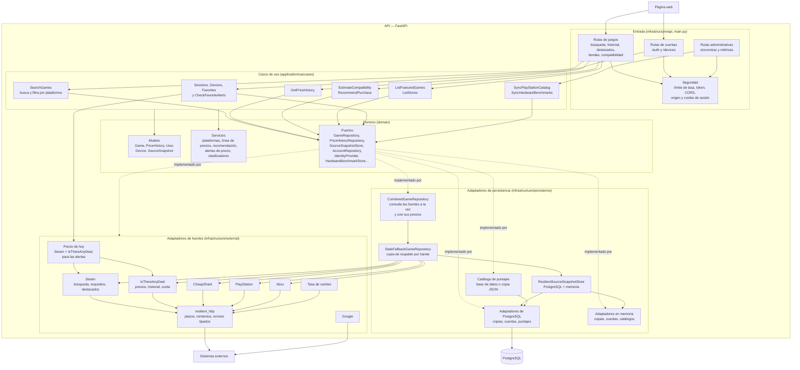
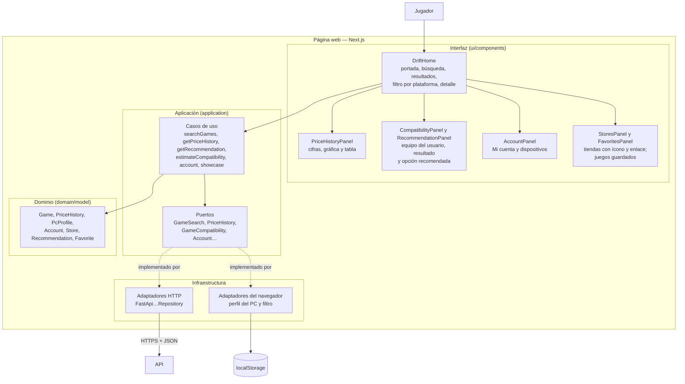
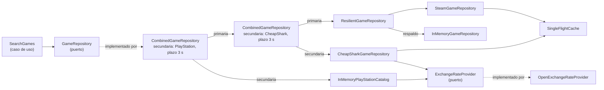

# C4 — Diagrama de Componentes de DRIFT

> **Qué vista usar.** La [«Vista vigente»](#vista-vigente-actualizada-el-12-de-noviembre-de-2026) describe el sistema actual. Lo que sigue a partir de [«Vista anterior»](#vista-anterior-octubre-de-2026) se conserva como registro: no incluye la base de datos, Xbox, IsThereAnyDeal, el historial ni las cuentas.

## Vista vigente (actualizada el 12 de noviembre de 2026)

Nivel 3: los componentes dentro de la API y de la página web. Incluye los cambios de ADR-0014 a ADR-0021, que a esa fecha están en la rama de trabajo y todavía no en `master`. Cada componente corresponde a archivos que existen en el repositorio.

### Componentes de la API

La API sigue la arquitectura hexagonal (ADR-0002): las rutas llaman a casos de uso, los casos de uso dependen de puertos del dominio, y los adaptadores implementan esos puertos. `backend/tests/test_architecture.py` falla si el dominio o la aplicación importan infraestructura.

| Componente | Archivos | Responsabilidad |
|---|---|---|
| Rutas de juegos | `backend/app/main.py` | `GET /games/search`, `/games/{id}/price-history`, `/games/featured`, `/stores`, `/hardware/gpus`, `/hardware/cpus` y `POST /games/{id}/compatibility`. |
| Rutas de cuentas | `infrastructure/api/account_routes.py` | `/auth/google/login`, `/auth/google/callback`, `/auth/me`, `/auth/logout` y `/devices`. |
| Rutas administrativas | `backend/app/main.py` | `POST /games/sync/playstation`, `POST /hardware/benchmarks/sync` y `GET /metrics`, con token. |
| Seguridad | `infrastructure/api/security.py`, `account_routes.py` | Límite de tasa por cliente, token administrativo, CORS acotado, comprobación del origen y cookie de sesión. |
| SearchGames | `application/usecases/search_games.py` | Busca en todas las tiendas y, si se piden plataformas, deja solo sus tiendas. |
| GetPriceHistory | `application/usecases/get_price_history.py` | Historial del mejor precio, o el motivo por el que no hay. |
| EstimateCompatibility | `application/usecases/estimate_compatibility.py` | Compara el PC del usuario con los requisitos, por puntaje o por niveles. |
| RecommendPurchase | `application/usecases/recommend_purchase.py`, `domain/services/recommendation.py` | Recomienda dónde comprar y en qué dispositivo jugar: cruza los precios con la compatibilidad de cada PC del usuario (ADR-0019). |
| ListFeaturedGames y ListStores | `application/usecases/showcase.py` | Lo que muestra la portada: los más vendidos del momento y las tiendas conectadas. |
| Sessions, Devices y Favorites | `application/usecases/accounts.py` | Iniciar y cerrar sesión, borrar la cuenta, administrar los dispositivos y los juegos favoritos con su precio objetivo (ADR-0020, ADR-0021). |
| CheckFavoriteAlerts | `application/usecases/favorite_alerts.py`, `domain/services/price_alerts.py` | Precio de hoy de los favoritos y cuáles llegaron a su objetivo o bajaron 5 % (ADR-0021). |
| Precio de hoy | `infrastructure/external/store_current_prices.py` | Mejor precio de PC de varios juegos a la vez: Steam en pesos e IsThereAnyDeal en dos llamadas, con caché de una hora. |
| Sincronizaciones | `sync_playstation_catalog.py`, `sync_hardware_benchmarks.py` | Cargas pedidas por el equipo; rechazan una respuesta vacía para no borrar lo guardado. |
| Servicios del dominio | `domain/services/` | Plataforma de cada tienda, línea del mejor precio y clasificadores de hardware. |
| CombinedGameRepository | `persistence/combined_game_repository.py` | Lanza cada fuente en un hilo, aplica el plazo y une los precios por identificador o por nombre. |
| StaleFallbackGameRepository | `persistence/stale_fallback_game_repository.py` | Envuelve a cada fuente: copia fresca 15 minutos, de respaldo hasta 72 horas. |
| ResilientSourceSnapshotStore | `persistence/resilient_source_snapshot_store.py` | Escribe en PostgreSQL y en memoria; si PostgreSQL falla, deja de llamarlo 30 segundos. |
| Adaptadores de PostgreSQL | `persistence/postgres_*.py` | Pool de conexiones con plazos cortos, migraciones y las tablas de copias, cuentas y puntajes. |
| Catálogo de puntajes | `persistence/json_hardware_benchmark_repository.py` | Lee de la base o de la copia JSON y reconoce modelos dentro del texto de los requisitos. |
| Steam | `external/steam/` | Búsqueda y precio en pesos, requisitos, precio regional para el historial y más vendidos. |
| IsThereAnyDeal | `external/isthereanydeal/` | Cliente con control de cuota, precios de tiendas de PC, lista de tiendas e historial. |
| Xbox | `external/xbox/` | Dos buscadores de la tienda a la vez y el catálogo de precios en pesos. |
| PlayStation, CheapShark, Google, tasa de cambio | `external/playstation/`, `cheapshark/`, `google/`, `exchange/` | Un adaptador por sistema externo. |
| resilient_http | `external/resilient_http.py` | Plazo por intento y plazo total, un reintento ante fallos transitorios y errores con causa. |

### Componentes de la página web

| Componente | Archivos | Responsabilidad |
|---|---|---|
| DriftHome | `frontend/ui/components/DriftHome.js` | Página principal: portada con los más vendidos, búsqueda, resultados, filtro «Tengo:» y detalle del juego. |
| PriceHistoryPanel | `ui/components/PriceHistoryPanel.js` | Mejor precio de hoy, más bajo en 12 meses, gráfica y tabla. |
| CompatibilityPanel | `ui/components/CompatibilityPanel.js` | Formulario del equipo y resultado por componente. |
| RecommendationPanel | `ui/components/RecommendationPanel.js` | Opción recomendada, su motivo, las alternativas y los dispositivos descartados. |
| AccountPanel | `ui/components/AccountPanel.js` | Botón de Google, dispositivos, cerrar sesión y borrar la cuenta. |
| FavoritesPanel | `ui/components/FavoritesPanel.js` | Juegos guardados con su precio de hoy, su alerta y el formulario «Avísame si baja de». |
| StoresPanel | `ui/components/StoresPanel.js` | Todas las tiendas, agrupadas por plataforma. |
| Casos de uso y puertos | `frontend/application/` | Validan antes de salir a la red y dependen de puertos, no de `fetch`. |
| Modelo | `frontend/domain/model/` | Reglas que no dependen de la interfaz: plataforma de cada tienda, filtro, cuándo aplica la compatibilidad o el historial. |
| Adaptadores HTTP | `frontend/infrastructure/http/` | Una llamada a la API por puerto; las de cuentas envían la cookie de sesión. |
| Adaptadores del navegador | `frontend/infrastructure/storage/` | Perfil del PC y plataformas elegidas en `localStorage`. |

### Recorrido de una búsqueda

1. La página llama a `GET /games/search?q=…`. El límite de tasa cuenta la petición.
2. `SearchGames` llama al puerto `GameRepository`, que implementa `CombinedGameRepository`.
3. Cada fuente (Steam, IsThereAnyDeal o CheapShark, PlayStation y Xbox) se consulta a la vez, envuelta en `StaleFallbackGameRepository`:
   - con una copia de menos de 15 minutos no se llama a la fuente;
   - si la fuente responde, se guarda su copia;
   - si falla o excede su plazo, se usa la copia de hasta 72 horas y se marca en `cached_sources`;
   - sin copia, la fuente queda en `unavailable_sources`.
4. Los precios se unen en un solo juego por identificador de Steam o por nombre normalizado.
5. La API devuelve precios, enlaces, descuentos y plataformas; la página aplica el filtro «Tengo:».

---

## Vista anterior (octubre de 2026)

> **Estado: anterior.** Describe el sistema antes de ADR-0014 a ADR-0018. Se conserva como registro.

El diagrama de nivel 3 muestra con mayor detalle la estructura interna de DRIFT y la comunicación entre los componentes que participan en la búsqueda de videojuegos. Se representan los componentes que actualmente existen en el repositorio, sin agregar componentes o funcionalidades que no estén implementados.

```mermaid
flowchart LR

    %% =====================================================
    %% ACTORES Y SISTEMAS EXTERNOS
    %% =====================================================

    USER["👤 Usuario / Jugador<br/><br/>Busca videojuegos,<br/>consulta precios y compatibilidad"]

    STEAM["🎮 Steam API<br/><br/>Servicio externo que proporciona<br/>información y precios de videojuegos"]

    PLAYSTATION["🎮 PlayStation API<br/><br/>Fuente externa del catálogo<br/>de videojuegos de PlayStation"]


    %% =====================================================
    %% FRONTEND
    %% =====================================================

    subgraph FRONTEND["🟦 DRIFT — Frontend Web"]

        subgraph UI["🖥️ Capa de Interfaz"]

            PAGE["📄 page.js<br/><br/>Punto de entrada de la<br/>aplicación web"]

            HOME["🎨 DriftHome<br/><br/>Interfaz principal de DRIFT<br/>para realizar búsquedas y<br/>consultar compatibilidad"]

        end


        subgraph FRONT_APP["⚙️ Capa de Aplicación"]

            FRONT_SEARCH["🔎 searchGames.js<br/><br/>Caso de uso del frontend<br/>para buscar videojuegos"]

            FRONT_PORT["🔗 GameSearchPort.js<br/><br/>Puerto utilizado para<br/>realizar la búsqueda"]

        end


        subgraph FRONT_INFRA["🌐 Capa de Infraestructura"]

            HTTP["🌐 FastApiGameRepository.js<br/><br/>Adaptador HTTP que implementa<br/>GameSearchPort y consume<br/>la API REST del backend"]

            COMPAT_HTTP["🌐 FastApiCompatibilityRepository.js<br/><br/>Adaptador HTTP utilizado para<br/>consultar la compatibilidad"]

        end

    end


    %% =====================================================
    %% BACKEND
    %% =====================================================

    subgraph BACKEND["🟪 DRIFT — Backend / API"]

        subgraph API_LAYER["🔌 Capa de Entrada"]

            API["🔌 main.py — FastAPI<br/><br/>Expone la API REST de DRIFT<br/><br/>Recibe solicitudes HTTP y<br/>ejecuta los casos de uso"]

        end


        subgraph APPLICATION["⚙️ Capa de Aplicación"]

            SEARCH["🔎 SearchGames<br/><br/>Caso de uso de búsqueda<br/>de videojuegos<br/><br/>Utiliza GameRepository"]

            SYNC_PS["🔄 SyncPlayStationCatalog<br/><br/>Caso de uso para actualizar<br/>el catálogo de PlayStation"]

            COMPAT["🖥️ EstimateCompatibility<br/><br/>Caso de uso de compatibilidad<br/>de PC"]

        end


        subgraph DOMAIN["🧠 Capa de Dominio"]

            GAME["🎮 Game<br/><br/>Entidad del dominio<br/><br/>id<br/>name<br/>prices"]

            PORT["🔗 GameRepository<br/><br/>Puerto del dominio<br/><br/>Define search(query)"]

            CATALOG_PORT["🔗 GameCatalogSource<br/><br/>Puerto para obtener<br/>un catálogo externo"]

            NORMALIZED_GAME["📦 NormalizedGame<br/><br/>Modelo normalizado utilizado<br/>para el catálogo externo"]

            REQUIREMENTS["🧩 GameRequirements<br/><br/>Modelo del dominio para<br/>requisitos de PC"]

            REQUIREMENTS_PORT["🔗 GameRequirementsRepository<br/><br/>Puerto para consultar<br/>requisitos de PC"]

        end


        subgraph INFRASTRUCTURE["🏗️ Capa de Infraestructura"]

            STEAM_REPO["🎮 SteamGameRepository<br/><br/>Adaptador externo<br/><br/>Implementa GameRepository<br/>y consulta Steam"]

            RESILIENT_REPO["🛡️ ResilientGameRepository<br/><br/>Implementa GameRepository<br/><br/>Usa Steam como fuente principal<br/>y un catálogo local de respaldo"]

            MEMORY_REPO["💾 InMemoryGameRepository<br/><br/>Repositorio local de respaldo<br/><br/>Implementa GameRepository"]

            COMBINED_REPO["🔀 CombinedGameRepository<br/><br/>Implementa GameRepository<br/><br/>Combina los resultados del<br/>repositorio principal con<br/>el catálogo local de PlayStation"]

            PS_SOURCE["🎮 PlayStationGameCatalogSource<br/><br/>Adaptador externo<br/><br/>Implementa GameCatalogSource,<br/>consulta PlayStation y normaliza<br/>los datos del catálogo"]

            PS_CATALOG["💾 InMemoryPlayStationCatalog<br/><br/>Catálogo local de PlayStation<br/><br/>Implementa GameRepository<br/>y almacena los juegos<br/>obtenidos mediante sincronización"]

            REQUIREMENTS_REPO["💾 InMemoryGameRequirementsRepository<br/><br/>Repositorio en memoria<br/><br/>Implementa GameRequirementsRepository"]

        end

    end


    %% =====================================================
    %% PERSISTENCIA PREVISTA
    %% =====================================================

    DB["🗄️ Base de datos DRIFT<br/><br/>Persistencia prevista<br/>para una evolución futura<br/><br/>No implementada actualmente"]


    %% =====================================================
    %% FLUJO PRINCIPAL DEL FRONTEND
    %% =====================================================

    USER -->|"1. Busca un videojuego"| HOME

    PAGE -->|"2. Carga la aplicación"| HOME

    HOME -->|"3. Solicita búsqueda"| FRONT_SEARCH

    FRONT_SEARCH -->|"4. Utiliza el puerto"| FRONT_PORT

    FRONT_PORT -->|"5. Implementado por"| HTTP

    HTTP -->|"6. GET /games/search?q=..."| API


    %% =====================================================
    %% BÚSQUEDA EN EL BACKEND
    %% =====================================================

    API -->|"7. Ejecuta SearchGames"| SEARCH

    SEARCH -->|"8. Solicita búsqueda"| PORT

    PORT -.->|"9. Implementado por"| COMBINED_REPO


    %% =====================================================
    %% COMBINACIÓN DE FUENTES
    %% =====================================================

    COMBINED_REPO -->|"10. Consulta repositorio principal"| RESILIENT_REPO

    COMBINED_REPO -->|"11. Consulta catálogo PlayStation"| PS_CATALOG


    %% =====================================================
    %% RESILIENCIA DE STEAM
    %% =====================================================

    RESILIENT_REPO -->|"12. Fuente principal"| STEAM_REPO

    RESILIENT_REPO -->|"13. Respaldo ante fallo"| MEMORY_REPO


    %% =====================================================
    %% STEAM
    %% =====================================================

    STEAM_REPO -->|"14. Consulta catálogo y detalles"| STEAM

    STEAM -->|"15. Retorna datos JSON"| STEAM_REPO

    STEAM_REPO -->|"16. Construye objetos Game"| RESILIENT_REPO


    %% =====================================================
    %% PLAYSTATION EN LA BÚSQUEDA
    %% =====================================================

    PS_CATALOG -->|"17. Devuelve juegos del catálogo local"| COMBINED_REPO

    COMBINED_REPO -->|"18. Combina resultados y precios"| GAME

    GAME -->|"19. Resultados de búsqueda"| SEARCH


    %% =====================================================
    %% RETORNO DE LA BÚSQUEDA
    %% =====================================================

    SEARCH -->|"20. Retorna lista de Game"| API

    API -->|"21. Respuesta JSON"| HTTP

    HTTP -->|"22. Recibe resultados"| FRONT_SEARCH

    FRONT_SEARCH -->|"23. Devuelve juegos"| HOME

    HOME -->|"24. Muestra nombres y precios"| USER


    %% =====================================================
    %% SINCRONIZACIÓN DEL CATÁLOGO PLAYSTATION
    %% =====================================================

    API -->|"25. POST /games/sync/playstation"| SYNC_PS

    SYNC_PS -->|"26. Solicita catálogo"| CATALOG_PORT

    CATALOG_PORT -.->|"27. Implementado por"| PS_SOURCE

    PS_SOURCE -->|"28. Consulta catálogo externo"| PLAYSTATION

    PLAYSTATION -->|"29. Retorna información del catálogo"| PS_SOURCE

    PS_SOURCE -->|"30. Normaliza información"| NORMALIZED_GAME

    NORMALIZED_GAME -->|"31. Catálogo normalizado"| SYNC_PS

    SYNC_PS -->|"32. Reemplaza catálogo local"| PS_CATALOG


    %% =====================================================
    %% COMPATIBILIDAD DE PC
    %% =====================================================

    USER -->|"33. Consulta compatibilidad"| HOME

    HOME -->|"34. Solicita compatibilidad"| COMPAT_HTTP

    COMPAT_HTTP -->|"35. POST /games/{game_id}/compatibility"| API

    API -->|"36. Ejecuta EstimateCompatibility"| COMPAT

    COMPAT -->|"37. Solicita requisitos"| REQUIREMENTS_PORT

    REQUIREMENTS_PORT -.->|"38. Implementado por"| REQUIREMENTS_REPO

    REQUIREMENTS_REPO -->|"39. Obtiene requisitos"| REQUIREMENTS

    REQUIREMENTS -->|"40. Entrega requisitos"| COMPAT

    COMPAT -->|"41. Retorna resultado"| API

    API -->|"42. Respuesta JSON"| COMPAT_HTTP

    COMPAT_HTTP -->|"43. Resultado"| HOME

    HOME -->|"44. Muestra compatibilidad"| USER


    %% =====================================================
    %% PERSISTENCIA FUTURA
    %% =====================================================

    DB -.->|"Evolución futura de persistencia"| PS_CATALOG
    DB -.->|"Evolución futura de persistencia"| MEMORY_REPO


    %% =====================================================
    %% ESTILOS
    %% =====================================================

    classDef actor fill:#FFFFFF,stroke:#333333,stroke-width:2px,color:#000000

    classDef frontend fill:#E3F2FD,stroke:#1565C0,stroke-width:2px,color:#000000

    classDef backend fill:#E8EAF6,stroke:#3949AB,stroke-width:2px,color:#000000

    classDef application fill:#FFF3E0,stroke:#EF6C00,stroke-width:2px,color:#000000

    classDef domain fill:#E8EAF6,stroke:#3949AB,stroke-width:2px,color:#000000

    classDef infrastructure fill:#FFF3E0,stroke:#EF6C00,stroke-width:2px,color:#000000

    classDef external fill:#FCE4EC,stroke:#C2185B,stroke-width:2px,color:#000000

    classDef planned fill:#F5F5F5,stroke:#757575,stroke-width:2px,stroke-dasharray:5 5,color:#555555


    class USER actor

    class PAGE,HOME,FRONT_SEARCH,FRONT_PORT,HTTP,COMPAT_HTTP frontend

    class API backend

    class SEARCH,SYNC_PS,COMPAT application

    class GAME,PORT,CATALOG_PORT,NORMALIZED_GAME,REQUIREMENTS,REQUIREMENTS_PORT domain

    class STEAM_REPO,RESILIENT_REPO,MEMORY_REPO,COMBINED_REPO,PS_SOURCE,PS_CATALOG,REQUIREMENTS_REPO infrastructure

    class STEAM,PLAYSTATION external

    class DB planned


    %% =====================================================
    %% LEYENDA
    %% =====================================================

    subgraph LEGEND["📖 Leyenda"]

        LEGEND_ACTOR["Persona"]

        LEGEND_FRONTEND["Frontend"]

        LEGEND_BACKEND["Backend"]

        LEGEND_DOMAIN["Dominio"]

        LEGEND_INFRA["Infraestructura"]

        LEGEND_EXTERNAL["Servicio externo"]

        LEGEND_PLANNED["Elemento previsto"]

    end

    class LEGEND_ACTOR actor
    class LEGEND_FRONTEND frontend
    class LEGEND_BACKEND backend
    class LEGEND_DOMAIN domain
    class LEGEND_INFRA infrastructure
    class LEGEND_EXTERNAL external
    class LEGEND_PLANNED planned
```

### Componentes principales

| Capa | Componente | Responsabilidad |
|---|---|---|
| Interfaz | `page.js` | Punto de entrada de la aplicación web. |
| Interfaz | `DriftHome` | Presenta la interfaz principal y permite realizar búsquedas. |
| Aplicación Frontend | `searchGames.js` | Ejecuta el caso de uso de búsqueda desde el frontend. |
| Puerto Frontend | `GameSearchPort.js` | Define la operación utilizada para realizar la búsqueda. |
| Infraestructura Frontend | `FastApiGameRepository.js`           | Implementa el puerto frontend y realiza las solicitudes HTTP al backend.                                                      |
| Infraestructura Frontend | `FastApiCompatibilityRepository.js`  | Realiza las solicitudes HTTP relacionadas con la compatibilidad.                                                              |
| Entrada Backend          | `main.py` / FastAPI                  | Expone los endpoints REST y conecta los casos de uso con sus dependencias.                                                    |
| Aplicación Backend       | `SearchGames`                        | Coordina la búsqueda mediante `GameRepository`.                                                                               |
| Aplicación Backend       | `SyncPlayStationCatalog`             | Coordina la actualización del catálogo de PlayStation mediante `GameCatalogSource`.                                           |
| Aplicación Backend       | `EstimateCompatibility`              | Ejecuta la estimación de compatibilidad de PC.                                                                                |
| Dominio                  | `Game`                               | Representa la entidad videojuego y contiene su identificador, nombre y precios.                                               |
| Dominio                  | `GameRepository`                     | Puerto utilizado para consultar videojuegos.                                                                                  |
| Dominio                  | `GameCatalogSource`                  | Puerto utilizado para obtener un catálogo externo y desacoplar el caso de uso de sincronización de la fuente concreta.        |
| Dominio                  | `NormalizedGame`                     | Representa la información normalizada obtenida desde una fuente externa antes de incorporarla al catálogo local.              |
| Dominio                  | `GameRequirements`                   | Representa los requisitos utilizados para estimar compatibilidad de PC.                                                       |
| Dominio                  | `GameRequirementsRepository`         | Puerto para consultar los requisitos de un videojuego.                                                                        |
| Infraestructura          | `SteamGameRepository`                | Implementa `GameRepository` y consulta directamente la API de Steam.                                                          |
| Infraestructura          | `ResilientGameRepository`            | Implementa `GameRepository`, utiliza Steam como fuente principal y `InMemoryGameRepository` como respaldo cuando Steam falla. |
| Infraestructura          | `InMemoryGameRepository`             | Implementa `GameRepository` y mantiene un catálogo local en memoria para respaldo.                                            |
| Infraestructura          | `CombinedGameRepository`             | Implementa `GameRepository` y combina los resultados del repositorio principal con el catálogo local de PlayStation.          |
| Infraestructura          | `PlayStationGameCatalogSource`       | Implementa `GameCatalogSource`, consulta el catálogo de PlayStation y transforma la respuesta al modelo `NormalizedGame`.     |
| Infraestructura          | `InMemoryPlayStationCatalog`         | Implementa `GameRepository` y mantiene en memoria los juegos obtenidos durante la sincronización de PlayStation.              |
| Infraestructura          | `InMemoryGameRequirementsRepository` | Implementa `GameRequirementsRepository` y proporciona el catálogo controlado de requisitos.                                   |
| Persistencia futura      | Base de datos DRIFT                  | Representa la evolución prevista de la persistencia. No corresponde a una implementación concreta existente actualmente.      |

## Flujo principal de búsqueda

El flujo de búsqueda comienza cuando el usuario realiza una consulta desde `DriftHome`. El frontend ejecuta `searchGames`, utiliza `GameSearchPort` y delega la comunicación HTTP en `FastApiGameRepository`.

En el backend, `main.py` recibe la solicitud `GET /games/search` y ejecuta `SearchGames`. Este caso de uso depende del puerto `GameRepository`, manteniendo la lógica de aplicación desacoplada de los adaptadores concretos.

La implementación utilizada por `SearchGames` es `CombinedGameRepository`. Este repositorio consulta el repositorio principal, compuesto por `ResilientGameRepository`, y también consulta `InMemoryPlayStationCatalog`.

`ResilientGameRepository` utiliza `SteamGameRepository` como fuente principal. Si la consulta a Steam falla de forma controlada (timeout, error de conexión, HTTP 429, 5xx, 4xx o respuesta inválida, ya con timeout explícito y un reintento acotado dentro del adaptador), utiliza `InMemoryGameRepository` como catálogo de respaldo y marca `Steam` en `unavailable_sources`. El diagrama no cambia: la resiliencia vive dentro del componente `SteamGameRepository` ([ADR-0009](../adr/0009-decision-extraccion-integracion-steam.md)).

Los resultados provenientes de Steam y del catálogo local de PlayStation son combinados por `CombinedGameRepository`. Cuando un videojuego coincide por nombre, los precios de las diferentes fuentes se integran en el objeto `Game`.

## Integración con PlayStation

La integración con PlayStation utiliza un flujo diferente al de Steam.

`PlayStationGameCatalogSource` implementa el puerto `GameCatalogSource`. Su responsabilidad es consultar el catálogo externo de PlayStation, procesar la respuesta y transformarla a objetos `NormalizedGame`.

El caso de uso `SyncPlayStationCatalog` recibe el `GameCatalogSource` y el catálogo local `InMemoryPlayStationCatalog`. Después de obtener correctamente el catálogo, reemplaza el contenido del catálogo local.

Posteriormente, `CombinedGameRepository` utiliza `InMemoryPlayStationCatalog` como repositorio secundario durante las búsquedas.

Por esta razón, `PlayStationGameCatalogSource` **no implementa `GameRepository`** y no se conecta directamente con `SearchGames`. La conexión con la búsqueda se produce mediante `InMemoryPlayStationCatalog` y `CombinedGameRepository`.

La actualización está expuesta mediante:

`POST /games/sync/playstation`

El contrato AsyncAPI de PlayStation documenta además el flujo lógico de solicitud de actualización, captura de videojuegos, finalización y manejo de errores. El mecanismo concreto de mensajería definido en dicho contrato todavía no sustituye el flujo HTTP implementado actualmente.

## Relación con la arquitectura hexagonal

El nivel 3 mantiene la separación entre aplicación, dominio e infraestructura.

Los casos de uso `SearchGames` y `SyncPlayStationCatalog` no dependen directamente de las APIs externas. `SearchGames` depende de `GameRepository`, mientras que `SyncPlayStationCatalog` depende de `GameCatalogSource`.

Los adaptadores concretos se encuentran en infraestructura:

* `SteamGameRepository` para Steam.
* `PlayStationGameCatalogSource` para PlayStation.
* `ResilientGameRepository` para tolerancia a fallos.
* `CombinedGameRepository` para combinar las fuentes utilizadas por la búsqueda.
* `InMemoryPlayStationCatalog` e `InMemoryGameRepository` para almacenamiento local en memoria.

La estructura permite incorporar o sustituir fuentes externas sin colocar la lógica específica de Steam o PlayStation dentro de los casos de uso.

## Persistencia

La implementación actual utiliza repositorios en memoria. No existe actualmente una implementación concreta de una base de datos para el catálogo de videojuegos.

Por esta razón, la base de datos DRIFT se representa en el diagrama como **persistencia prevista**, sin asociarla a una tecnología específica.

La representación de este elemento no significa que exista actualmente una conexión funcional con una base de datos. Su propósito es mantener visible la evolución prevista del contenedor de persistencia definido en el C4 nivel 2.

## Flujo resumido de búsqueda

`Usuario → DriftHome → searchGames → GameSearchPort → FastApiGameRepository → FastAPI → SearchGames → GameRepository → CombinedGameRepository`

Desde `CombinedGameRepository`:

`CombinedGameRepository → ResilientGameRepository → SteamGameRepository → Steam API`

y:

`CombinedGameRepository → InMemoryPlayStationCatalog`

El flujo de sincronización de PlayStation es independiente:

`FastAPI → SyncPlayStationCatalog → GameCatalogSource → PlayStationGameCatalogSource → PlayStation API`

y posteriormente:

`PlayStationGameCatalogSource → NormalizedGame → SyncPlayStationCatalog → InMemoryPlayStationCatalog`

Finalmente, el catálogo local de PlayStation queda disponible para `CombinedGameRepository` durante las búsquedas.

## Actualización de octubre de 2026: CheapShark, tasa de cambio y degradación controlada

Componentes de infraestructura añadidos o modificados; el dominio, los puertos existentes y los casos de uso no cambiaron ([ADR-0008](../adr/0008-persistencia-ejecucion-y-degradacion-de-fuentes.md)).

| Capa | Componente | Responsabilidad |
|---|---|---|
| Dominio | `ExchangeRateProvider` | Puerto de la tasa USD a COP; lo usan los adaptadores que reciben precios en dólares. |
| Infraestructura | `CheapSharkGameRepository` | Implementa `GameRepository` con los precios de tiendas de PC de CheapShark, convertidos a COP. |
| Infraestructura | `OpenExchangeRateProvider` | Implementa `ExchangeRateProvider` con caché de 12 h y tasa de respaldo. |
| Infraestructura | `SingleFlightCache` | Caché con vencimiento y una sola carga en vuelo por clave; su lock no cubre la llamada HTTP. |
| Infraestructura | `CombinedGameRepository` | Consulta la fuente secundaria en paralelo, la espera como máximo `DRIFT_SOURCE_TIMEOUT_SECONDS` (3 s) y, si falla o vence, añade su nombre a `unavailable_sources`. |
| Infraestructura | `game_copy.copy_games` | Entrega copias de los juegos en caché o en memoria, para que una búsqueda no altere lo que reciben las demás. |
| Infraestructura | `resilient_http.get_json` y `TimeBudget` | Política HTTP común de las fuentes externas (timeout, reintentos, `Retry-After`, errores tipados) y plazo total compartido por las llamadas de una operación (S12; [arc42 §8.15](../arc42/arc42_8_conceptos_transversales.md)). |
| Infraestructura | `SearchMetrics` | Además de la latencia, cuenta las búsquedas degradadas por fuente (`drift_source_unavailable_total`). |

`backend/tests/test_architecture.py` falla si el dominio o la aplicación importan infraestructura.
