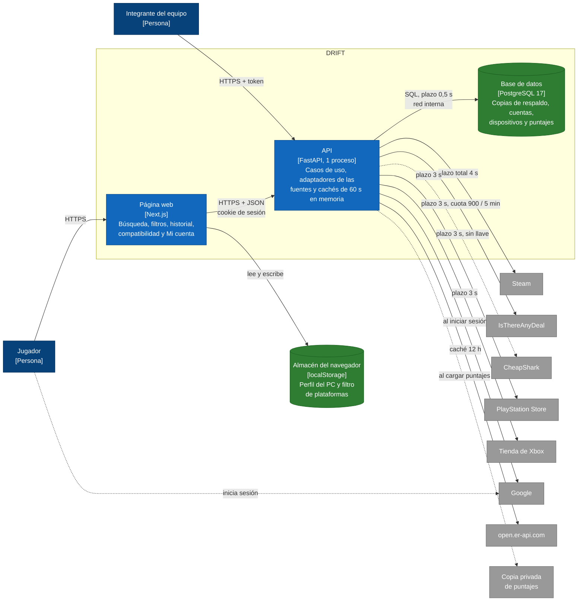

# C4 — Diagrama de Contenedores de DRIFT

> **Qué vista usar.** La vista que describe el sistema actual es la [«Vista vigente»](#vista-vigente-actualizada-el-12-de-noviembre-de-2026), a continuación. La [«Vista histórica»](#vista-histórica-anterior-a-octubre-de-2026-no-describe-el-sistema-actual), al final del documento, se conserva solo como registro y **no debe usarse** para razonar sobre el sistema.

## Vista vigente (actualizada el 12 de noviembre de 2026)

Esta es la vista del nivel 2 que describe el sistema actual. Incluye los cambios de [ADR-0014](../adr/0014-postgresql-como-persistencia.md) a [ADR-0018](../adr/0018-puntajes-de-hardware-en-la-base-de-datos.md), que a esa fecha están en la rama de trabajo y todavía no en `master`. La versión anterior de esta vista (20 de octubre de 2026, sin base de datos) queda en el historial de git.

DRIFT tiene **tres contenedores propios**: la página web, la API y la base de datos. No hay colas ni microservicios, y la comunicación es síncrona.

Todas las flechas hacia sistemas externos son HTTPS con JSON. Una línea punteada es una relación que solo ocurre en algunos casos.

### Contenedores

| Contenedor | Tecnología | Responsabilidad | Qué guarda |
|---|---|---|---|
| **Página web** | Next.js (React), 192 MB | Interfaz: búsqueda, filtro por plataforma, detalle con precios e historial, compatibilidad, tiendas y «Mi cuenta». Organizada también en dominio, aplicación e infraestructura. | Nada en el servidor. |
| **API** | FastAPI, 1 proceso, 192 MB | Expone las rutas HTTP, ejecuta los casos de uso y habla con todas las fuentes externas mediante adaptadores. Aplica el límite de tasa, el token administrativo y la sesión. | En memoria: cachés de 60 s por fuente, catálogo de PlayStation, métricas, y un segundo respaldo de las copias. Se pierde al reiniciar. |
| **Base de datos** | PostgreSQL 17, 96 MB, volumen `drift_pgdata` | Lo que debe sobrevivir a un reinicio. Solo la API la alcanza, por la red interna del compose. | Copias de respaldo de las fuentes (72 h), cuentas, sesiones, dispositivos y puntajes de hardware. |
| **Almacén del navegador** | `localStorage` | Lo que el usuario sin sesión conserva en su propio navegador. | Perfil del PC (`drift.pcProfile`) y plataformas elegidas (`drift.platformFilter`). |

### Qué pasa cuando algo falla

| Falla | Comportamiento | Decisión |
|---|---|---|
| Una fuente de precios no responde o se queda sin cuota | La búsqueda responde con su última copia (hasta 72 h) y lo avisa en `cached_sources`. Sin copia, la fuente va a `unavailable_sources`. | ADR-0015 |
| La base de datos no responde | La búsqueda sigue con las copias en memoria; los puntajes se leen de su copia JSON. Las cuentas y los dispositivos responden «no disponible». | ADR-0014, ADR-0017, ADR-0018 |
| Google no responde | Nadie puede iniciar sesión; quien ya tiene sesión no se ve afectado. | ADR-0017 |
| Falta la llave de IsThereAnyDeal | Las tiendas de PC salen de CheapShark y no hay historial. | ADR-0016 |

### Aspectos transversales

| Aspecto | Estado real |
|---|---|
| Modelo de ejecución | Síncrono. En cada búsqueda las cuatro fuentes se consultan a la vez, con hilos; no hay cola ni planificador. |
| Sesión | Cookie `HttpOnly` y `SameSite=Lax`; en la base solo se guarda la huella del identificador. |
| Configuración y secretos | Variables de entorno en Dokploy: contraseña de la base, llave de IsThereAnyDeal, secreto del cliente de Google, token administrativo y direcciones de la copia de puntajes. |
| Despliegue | Servidor del laboratorio (`https://drift.iscoutb.dev`): Docker Compose en Dokploy con 3 contenedores y 480 MB de 512 MB. Los despliegues en Azure App Service y Vercel están en retiro: allí no hay base de datos y el inicio de sesión no funciona. |

### Lo que no se ha comprobado

Esta vista describe el código y el archivo `deploy/compose.lab.yaml`. **El contenedor de la base de datos no se ha levantado en el laboratorio**: la base se probó en un equipo de desarrollo con PostgreSQL 16.2. Falta confirmar que arranca dentro de 96 MB y que Dokploy acepta el volumen con nombre.

---

## Vista histórica (anterior a octubre de 2026): no describe el sistema actual

> **Estado: histórica.** Se elaboró al inicio del diseño, antes de ADR-0008 (11 de octubre de 2026), con el propósito de mostrar la descomposición prevista del sistema por responsabilidades. **No describe el sistema actual y mezcla niveles:** coloca en un mismo diagrama contenedores (frontend, API), capas internas del backend (aplicación, dominio, adaptadores) y una «Base de datos» que **no existe**. DRIFT no tiene base de datos, cola ni microservicios; el almacenamiento es memoria del proceso (ADR-0008). Se conserva porque documenta la intención original; para el estado real, ver la vista vigente y el [nivel 3](componentes.md).

El diagrama de contenedores representa la descomposición interna del sistema DRIFT. Cada contenedor representa una unidad principal de ejecución o responsabilidad dentro del sistema y muestra cómo se relaciona con los actores y sistemas externos definidos en el diagrama de contexto.

```mermaid
flowchart LR

    %% =========================
    %% ACTORES Y SISTEMAS EXTERNOS
    %% =========================

    USER["👤 Usuario / Jugador<br/><br/>Consulta videojuegos,<br/>precios y ofertas"]

    STEAM["🎮 Steam API<br/><br/>Proporciona información<br/>y precios de videojuegos"]

    PLAYSTATION["🎮 PlayStation API<br/><br/>Proporciona información<br/>y catálogo de videojuegos"]

    %% =========================
    %% SISTEMA DRIFT
    %% =========================

    subgraph DRIFT["🟦 SISTEMA DRIFT"]

        %% -------------------------
        %% ADAPTADORES DE ENTRADA
        %% -------------------------

        subgraph INPUT["⬅️ ADAPTADORES DE ENTRADA"]

            WEB["🌐 Frontend Web — Next.js<br/><br/>Interfaz que permite al usuario<br/>buscar videojuegos y consultar<br/>su información y precios"]

            API["🔌 API REST — FastAPI<br/><br/>Recibe las solicitudes HTTP,<br/>valida los parámetros y conecta<br/>la interfaz con los casos de uso"]

        end

        %% -------------------------
        %% NÚCLEO HEXAGONAL
        %% -------------------------

        subgraph CORE["NÚCLEO HEXAGONAL"]

            APP["⚙️ Casos de uso<br/><br/>Ejecuta la lógica de aplicación<br/>para buscar videojuegos y coordinar<br/>el acceso a los repositorios"]

            DOMAIN["🧠 Dominio — Game<br/><br/>Representa el videojuego y contiene<br/>los datos principales del negocio,<br/>como identificador, nombre y precios"]

            PORT["🔗 Puerto — GameRepository<br/><br/>Define la interfaz que permite<br/>consultar videojuegos sin depender<br/>de una implementación específica"]

        end

        %% -------------------------
        %% ADAPTADORES DE SALIDA
        %% -------------------------

        subgraph OUTPUT["➡️ ADAPTADORES DE SALIDA"]

            STEAM_ADAPTER["🎮 Adaptador Steam<br/><br/>Implementa GameRepository y traduce<br/>las solicitudes de DRIFT a llamadas<br/>hacia la API externa de Steam"]

            PLAYSTATION_ADAPTER["🎮 Adaptador PlayStation<br/><br/>Gestiona la integración con PlayStation<br/>y transforma la información externa<br/>al modelo utilizado por DRIFT"]

            PERSIST["💾 Adaptador de Persistencia<br/><br/>Implementa GameRepository y se encarga<br/>de guardar y recuperar la información<br/>desde el sistema de almacenamiento"]

        end

        %% -------------------------
        %% BASE DE DATOS
        %% -------------------------

        DB[("🗄️ Base de datos DRIFT<br/><br/>Almacena de forma persistente<br/>videojuegos, precios y demás<br/>información necesaria del sistema")]

    end

    %% =========================
    %% FLUJO DE ENTRADA
    %% =========================

    USER -->|"1. HTTPS + interacción web"| WEB

    WEB -->|"2. HTTP/REST + JSON"| API

    API -->|"3. Invocación de caso de uso"| APP

    %% =========================
    %% NÚCLEO
    %% =========================

    APP -->|"4. Acceso a entidades y reglas de dominio"| DOMAIN

    APP -->|"5. Invocación del puerto GameRepository"| PORT

    %% =========================
    %% PUERTOS Y ADAPTADORES
    %% =========================

    PORT -.->|"Implementación del puerto"| STEAM_ADAPTER

    PORT -.->|"Implementación del puerto"| PLAYSTATION_ADAPTER

    PORT -.->|"Implementación del puerto"| PERSIST

    %% =========================
    %% FUENTES EXTERNAS
    %% =========================

    STEAM_ADAPTER -->|"6. HTTP/REST + JSON"| STEAM

    PLAYSTATION_ADAPTER -->|"7. HTTP/REST + JSON"| PLAYSTATION

    %% =========================
    %% BASE DE DATOS
    %% =========================

    PERSIST -->|"8. Persistencia de datos"| DB

    %% =========================
    %% ESTILOS
    %% =========================

    classDef actor fill:#ffffff,stroke:#333333,stroke-width:2px,color:#000000
    classDef core fill:#e8f0fe,stroke:#1a73e8,stroke-width:2px,color:#000000
    classDef adapter fill:#fff3e0,stroke:#f57c00,stroke-width:2px,color:#000000
    classDef database fill:#e8f5e9,stroke:#2e7d32,stroke-width:2px,color:#000000
    classDef external fill:#fce4ec,stroke:#c2185b,stroke-width:2px,color:#000000

    class USER actor
    class APP,DOMAIN,PORT core
    class WEB,API,STEAM_ADAPTER,PLAYSTATION_ADAPTER,PERSIST adapter
    class DB database
    class STEAM,PLAYSTATION external

```

### Contenedores (histórico)

| Contenedor                          | Responsabilidad                                                                                                                                                                                                                                                | Relación principal                                   |
| ----------------------------------- | -------------------------------------------------------------------------------------------------------------------------------------------------------------------------------------------------------------------------------------------------------------- | ---------------------------------------------------- |
| **Web / Frontend**                  | Proporciona la interfaz con la que el jugador consulta videojuegos, precios y ofertas. Está desarrollado con Next.js.                                                                                                                                          | Jugador → Web                                        |
| **API REST / Backend**              | Recibe las solicitudes HTTP, valida los parámetros y comunica la interfaz con los casos de uso de la aplicación. Está desarrollado con FastAPI.                                                                                                                | Web → API mediante HTTP/REST + JSON                  |
| **Aplicación / Casos de uso**       | Coordina las operaciones principales de DRIFT, como la búsqueda de videojuegos y la consulta de información mediante los puertos definidos por el dominio.                                                                                                     | API → Aplicación                                     |
| **Dominio**                   | Contiene las entidades y reglas principales del negocio, además de los puertos que permiten mantener el núcleo independiente de la infraestructura.                                                                                                            | Aplicación → Dominio                                       |
| **Adaptador de Steam**        | Implementa `GameRepository`, gestiona la comunicación con Steam y transforma la información externa al modelo utilizado por DRIFT.                                                                                                                             | Puerto → Adaptador → Steam mediante HTTP/REST + JSON       |
| **Adaptador de PlayStation**  | Gestiona la integración con la API de PlayStation y transforma la información externa al modelo utilizado por DRIFT.                                                                                                                                           | Puerto → Adaptador → PlayStation mediante HTTP/REST + JSON |
| **Adaptador de persistencia** | Implementa el puerto de persistencia y proporciona el mecanismo para guardar y recuperar la información del sistema. Actualmente se dispone de un repositorio en memoria y se contempla la integración con la base de datos como evolución de la arquitectura. | Puerto → Persistencia → Base de datos                        |
| **Base de datos**                   | Representa el mecanismo de almacenamiento persistente previsto para DRIFT, destinado a conservar videojuegos, precios y demás información necesaria del sistema.                                                                                               | Persistencia → Base de datos                         |

### Relaciones principales (histórico)

* El **Jugador** realiza consultas mediante el **Frontend Web** utilizando la interfaz web.
* El **Frontend Web** envía las solicitudes al **Backend/API REST** mediante HTTP/REST + JSON.
* El **Backend/API REST** valida las solicitudes y ejecuta los casos de uso correspondientes.
* Los **casos de uso** utilizan las entidades y puertos definidos en el **dominio**.
* El **dominio** no depende directamente de tecnologías externas; utiliza **puertos** para comunicarse con los adaptadores.
* El **puerto GameRepository** es implementado por los adaptadores que proporcionan las diferentes estrategias de acceso a los datos.
* El **adaptador de Steam** implementa el puerto correspondiente y se comunica con la **Steam API** mediante HTTP/REST + JSON.
* El **adaptador de persistencia** implementa el puerto de repositorio y se comunica con la **base de datos**.
* La **base de datos** se encuentra dentro del límite del sistema DRIFT y representa el mecanismo de almacenamiento persistente  previsto para la evolución de la arquitectura.
* Actualmente, el proyecto cuenta con un mecanismo de persistencia en memoria, mientras que la integración con una base de datos constituye parte de la arquitectura prevista.
* Los servicios externos, como **Steam**, permanecen fuera del límite de DRIFT.

### Coherencia con la arquitectura (histórico)

Los adaptadores permiten que el núcleo de DRIFT no dependa directamente de una tecnología específica. Por ejemplo, el caso de uso de búsqueda trabaja con el puerto `GameRepository`, mientras que diferentes adaptadores pueden implementar dicho puerto para consultar Steam o almacenar información en una base de datos.

Esta separación facilita reemplazar o agregar nuevas fuentes de información y mecanismos de persistencia sin modificar directamente las reglas principales del negocio, contribuyendo al atributo de calidad prioritario de **mantenibilidad**.

### Relación con el nivel 3 (histórico)

El **C4 nivel 2** presenta los principales contenedores que forman DRIFT y sus relaciones. El **C4 nivel 3** realiza un mayor nivel de detalle sobre el Backend/API, mostrando componentes como `SearchGames`, `Game`, `GameRepository`, `SteamGameRepository` y el adaptador de persistencia.
