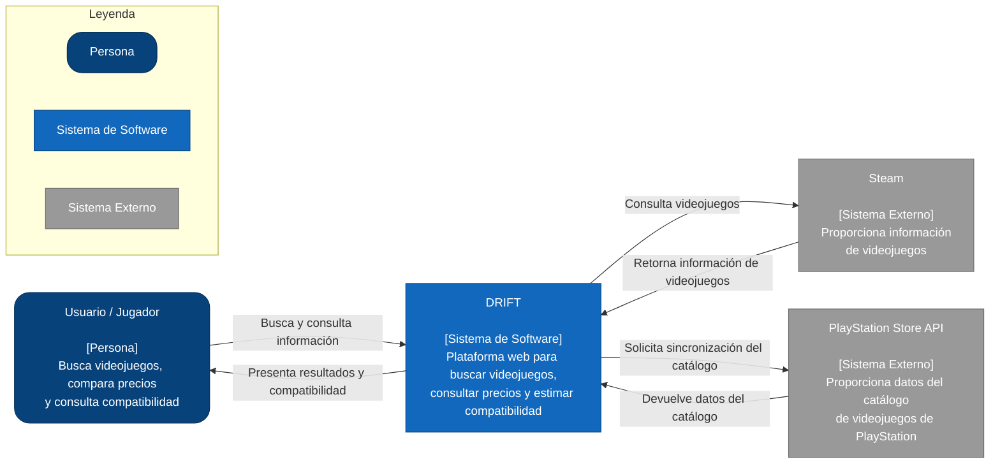

# C4 — Diagrama de contexto de DRIFT

## Objetivo

El diagrama de contexto representa a DRIFT como una plataforma web para buscar videojuegos, consultar precios y estimar la compatibilidad de juegos con un equipo de PC. Identifica al usuario, el sistema principal y las plataformas externas que proporcionan información.

## Diagrama de contexto

## Elementos del diagrama

| Elemento | Descripción |
|---|---|
| Usuario / Jugador | Interactúa con DRIFT para buscar videojuegos, consultar precios y revisar la compatibilidad de PC. |
| DRIFT | Sistema que integra la interfaz web, la API REST y los casos de uso de la aplicación. |
| Steam | Fuente externa consultada para obtener información de videojuegos. |
| PlayStation Store API | Fuente externa utilizada para obtener el catálogo de PlayStation durante la sincronización. |

## Relaciones principales

| Origen | Destino | Descripción |
|---|---|---|
| Usuario | DRIFT | Realiza búsquedas y consulta los resultados presentados por la plataforma. |
| DRIFT | Usuario | Presenta información de videojuegos y resultados de compatibilidad. |
| DRIFT | Steam | Consulta información de videojuegos mediante el adaptador correspondiente. |
| Steam | DRIFT | Devuelve los datos obtenidos de la plataforma externa. |
| DRIFT | PlayStation Store API | Solicita información para actualizar el catálogo de PlayStation. |
| PlayStation Store API | DRIFT | Devuelve los datos que el sistema normaliza y almacena en memoria. |

## Alcance

Este diagrama presenta las relaciones externas de DRIFT sin detallar la organización interna del frontend, los casos de uso, los puertos o los adaptadores. Estos elementos se desarrollan en los diagramas C4 de contenedores y componentes.

La integración con PlayStation corresponde a un flujo de sincronización del catálogo. No debe interpretarse como una consulta en tiempo real a PlayStation por cada búsqueda del usuario.

