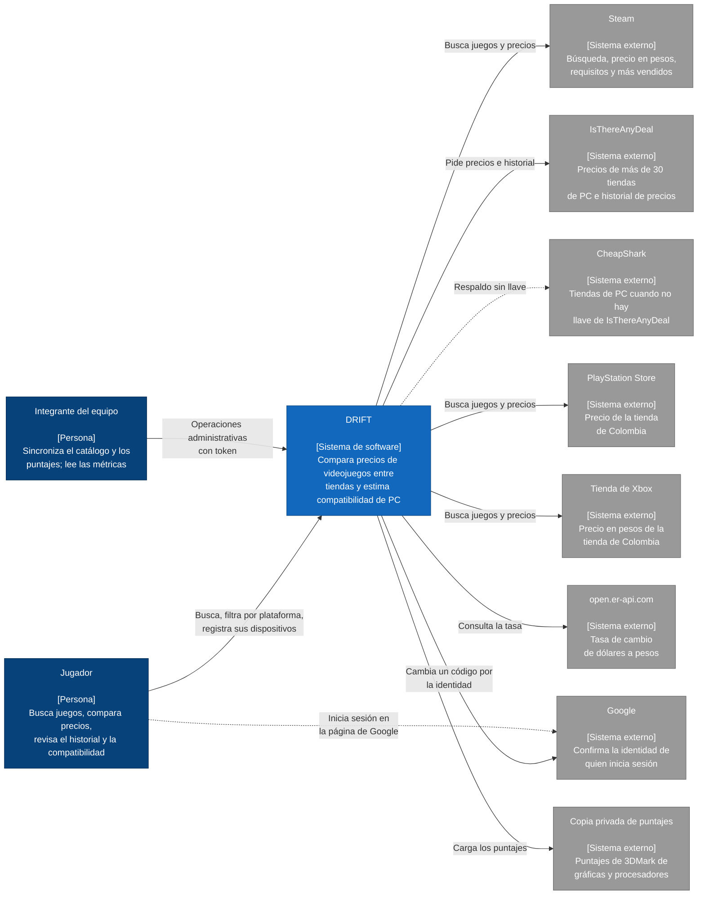

# C4 — Diagrama de contexto de DRIFT

> **Actualizado el 12 de noviembre de 2026.** Describe el proyecto con los cambios de ADR-0014 a ADR-0018, que a esa fecha están en la rama de trabajo y todavía no en `master`.

## Objetivo

El diagrama de contexto muestra a DRIFT como una sola caja: una plataforma web para buscar videojuegos, comparar su precio entre tiendas de PC y de consola, ver cómo se ha movido ese precio y saber si un juego corre en el PC del usuario. Identifica a quienes la usan y los sistemas externos de los que depende.

## Diagrama de contexto

Las cajas azul oscuro son personas, la azul es DRIFT y las grises son sistemas externos. Una línea punteada es una relación que solo ocurre en algunos casos.

## Elementos del diagrama

| Elemento | Descripción |
|---|---|
| Jugador | Usa DRIFT sin registrarse. Si inicia sesión con Google puede guardar varios dispositivos (PC y consolas). |
| Integrante del equipo | Con el token administrativo sincroniza el catálogo de PlayStation, recarga los puntajes de hardware y lee las métricas (ADR-0011, ADR-0018). |
| DRIFT | El sistema: página web, API y base de datos. Su interior está en el [diagrama de contenedores](contenedores.md). |
| Steam | Fuente principal. Da la búsqueda, el precio en pesos de Colombia, los requisitos de PC y la lista de los más vendidos que muestra la portada. |
| IsThereAnyDeal | Precios de las demás tiendas de PC y el registro de cambios de precio de los últimos 12 meses. Pide una llave y limita a 1.000 llamadas cada 5 minutos (ADR-0016). |
| CheapShark | Las tiendas de PC cuando no hay llave de IsThereAnyDeal. No ofrece historial. |
| PlayStation Store | Precio de la versión de PlayStation en la tienda de Colombia, que cobra en dólares. |
| Tienda de Xbox | Precio en pesos de la versión de Xbox. Son los buscadores y el catálogo de la tienda web de Microsoft, sin contrato publicado. |
| Google | Proveedor de identidad. DRIFT no guarda contraseñas (ADR-0017). |
| open.er-api.com | Tasa para convertir a pesos los precios que llegan en dólares. |
| Copia privada de puntajes | Dos archivos JSON con puntajes de 3DMark (UL Solutions), en una dirección privada. DRIFT los carga en su base de datos (ADR-0018). |

## Relaciones principales

| Origen | Destino | Descripción |
|---|---|---|
| Jugador | DRIFT | Busca, filtra por plataforma, abre el historial de un juego y comprueba la compatibilidad con su PC. |
| Jugador | Google | Al iniciar sesión, escribe su contraseña en la página de Google, nunca en DRIFT. |
| DRIFT | Steam, IsThereAnyDeal, PlayStation Store, Tienda de Xbox | En cada búsqueda consulta las cuatro a la vez, con un plazo por fuente. Si una falla, responde con su última copia guardada o avisa que no está disponible (ADR-0015). |
| DRIFT | Google | Cambia el código que Google devuelve por la identidad de la persona. |
| DRIFT | Copia privada de puntajes | Solo en el primer arranque con la base vacía y cuando alguien pide recargar los puntajes. |

## Alcance

Este diagrama no muestra el interior de DRIFT. Los contenedores están en [contenedores.md](contenedores.md) y los componentes en [componentes.md](componentes.md).

Todas las fuentes de precios se consultan en el momento de la búsqueda. DRIFT no descarga catálogos completos de ninguna tienda, salvo una página del catálogo de PlayStation cuando un integrante del equipo lo pide.
