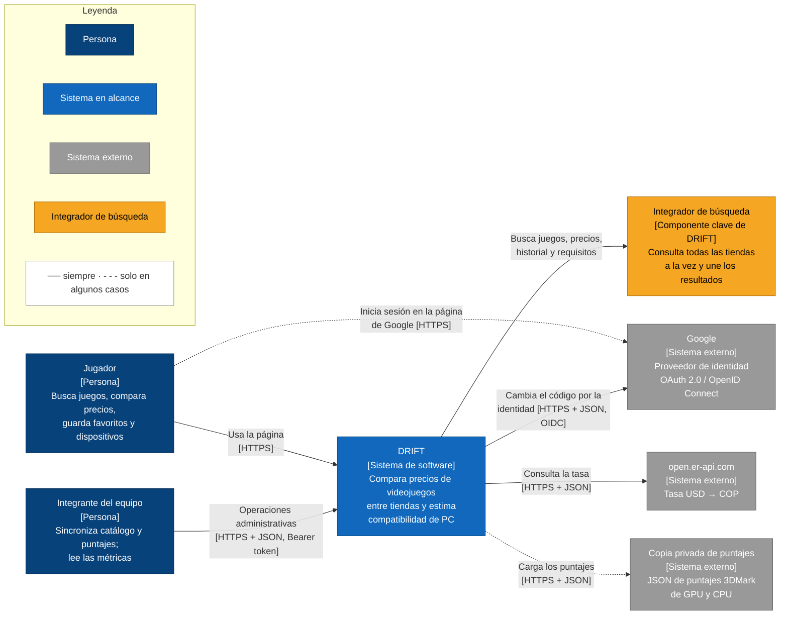

# C4 — Nivel 1: diagrama de contexto de DRIFT

> **Vista vigente.** Revisada el 23 de noviembre de 2026 contra `master` en `b841450` (el código no cambió desde `6bbf83e`). Describe el sistema que está en la rama principal, no planes. Las versiones anteriores quedan en el historial de git de este archivo.

## Objetivo

El diagrama de contexto muestra a DRIFT como una sola caja: una plataforma web para buscar videojuegos, comparar su precio entre tiendas de PC y de consola, ver cómo se ha movido ese precio, recibir una recomendación de compra y saber si un juego corre en el PC del usuario. Identifica a quienes la usan y los sistemas externos de los que depende.

Por indicación del profesor, las tiendas (Steam, IsThereAnyDeal, CheapShark, PlayStation Store y la tienda de Xbox) no aparecen en este nivel ni en el [nivel 2](contenedores.md): las representa el **integrador de búsqueda**, el componente que consulta todas las tiendas a la vez y une sus resultados. En C4 estricto un componente no va en el contexto; se muestra porque es el núcleo de lo que hace DRIFT. Se despliega completo, con cada tienda, en el [nivel 3](componentes.md#integrador-de-búsqueda-desplegado).

## Diagrama de contexto

Las cajas azul oscuro son personas, la azul es DRIFT, la naranja es el integrador de búsqueda y las grises son sistemas externos. Una línea continua es una relación que ocurre siempre que se usa la función; una punteada, una que solo ocurre en algunos casos.

## Elementos del diagrama

| Elemento | Tipo | Descripción | Dónde está en el código |
|---|---|---|---|
| Jugador | Persona | Usa DRIFT sin registrarse. Si inicia sesión con Google puede guardar varios dispositivos (PC y consolas) y juegos favoritos con un precio objetivo. | `frontend/ui/components/` |
| Integrante del equipo | Persona | Con el token administrativo sincroniza el catálogo de PlayStation, recarga los puntajes de hardware y lee las métricas (ADR-0011, ADR-0018). | `backend/app/main.py` (`/games/sync/playstation`, `/hardware/benchmarks/sync`, `/metrics`) |
| DRIFT | Sistema en alcance | Página web, API y base de datos. Su interior está en el [nivel 2](contenedores.md). | `frontend/`, `backend/`, `deploy/compose.lab.yaml` |
| Integrador de búsqueda | Componente clave de DRIFT | Representa todo el acceso a las tiendas: Steam (fuente principal, precio en pesos, requisitos, más vendidos y «Explorar»), IsThereAnyDeal (precios de referencia de las demás tiendas de PC e historial de 12 meses; o CheapShark si no hay llave) y las tiendas de PlayStation y Xbox de Colombia. En cada búsqueda las consulta a la vez, une los resultados del mismo juego y, si una falla, responde con su última copia (ADR-0015). Las tiendas y sus adaptadores se ven en el [nivel 3](componentes.md#integrador-de-búsqueda-desplegado). | `backend/app/infrastructure/persistence/combined_game_repository.py`, armado en `backend/app/main.py`; adaptadores en `backend/app/infrastructure/external/` |
| Google | Sistema externo | Proveedor de identidad (OpenID Connect). DRIFT no guarda contraseñas ni tokens de Google (ADR-0017). | `backend/app/infrastructure/external/google/` |
| open.er-api.com | Sistema externo | Tasa para convertir a pesos los precios que llegan en dólares. Con fallo, se usa `USD_TO_COP_RATE`. | `backend/app/infrastructure/external/exchange/` |
| Copia privada de puntajes | Sistema externo | Dos archivos JSON con puntajes de 3DMark en direcciones privadas (`DRIFT_GPU_BENCHMARKS_URL`, `DRIFT_CPU_BENCHMARKS_URL`). DRIFT los carga en su base de datos (ADR-0018). | `backend/app/infrastructure/persistence/json_hardware_benchmark_repository.py` |

## Relaciones principales

| Origen | Destino | Protocolo | Cuándo |
|---|---|---|---|
| Jugador | DRIFT | HTTPS | Siempre: búsqueda, filtro por plataforma, historial, compatibilidad, recomendación, favoritos. |
| Jugador | Google | HTTPS | Solo al iniciar sesión: escribe su contraseña en la página de Google, nunca en DRIFT. |
| Integrante del equipo | DRIFT | HTTPS + JSON, `Authorization: Bearer` | Solo para operaciones administrativas. |
| DRIFT | Integrador de búsqueda | Llamada interna | En cada búsqueda. El integrador consulta las tiendas a la vez por HTTPS + JSON, con un plazo por fuente; si una falla, responde con su última copia guardada o avisa que no está disponible (ADR-0015). La portada, «Explorar», el historial y las alertas también van a Steam o IsThereAnyDeal, y en este nivel quedan dentro de la misma caja. |
| DRIFT | Google | HTTPS + JSON (OIDC) | Al volver del inicio de sesión: cambia el código por el `id_token`. |
| DRIFT | open.er-api.com | HTTPS + JSON | Cuando necesita convertir y su caché de 12 horas venció. |
| DRIFT | Copia privada de puntajes | HTTPS + JSON | Solo en el primer arranque con la base vacía y cuando el equipo pide recargar los puntajes. |

## Alcance y límites

- Este diagrama no muestra el interior de DRIFT: los contenedores están en el [nivel 2](contenedores.md) y los componentes en el [nivel 3](componentes.md).
- Todas las fuentes de precios se consultan en el momento de la búsqueda. DRIFT no descarga catálogos completos, salvo una página del catálogo de PlayStation cuando el equipo lo pide.
- No hay envío de correos, pagos ni integración con cuentas de las tiendas: el usuario compra en la página de cada tienda, que DRIFT abre en una pestaña nueva.
